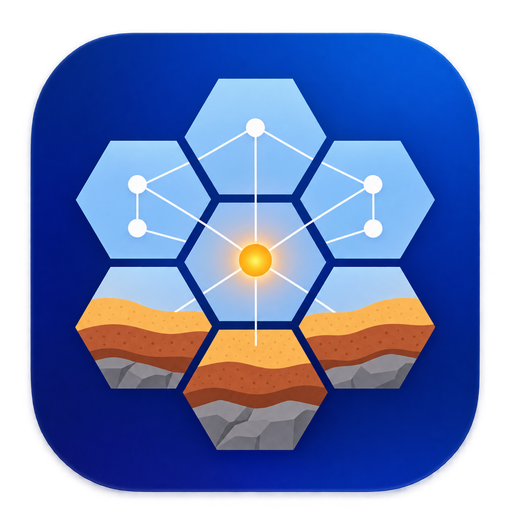

<p align="center"></p>

# TellusHive

TellusHive is an open-source multi-agent system for civil-engineering design, written entirely
in Rust. The engineer chats with a coordinator agent, which hands the work to a team of
specialists that calculate to the chosen standards, check each other's results, draw, write the
calculation report and drive FE programs such as Tellus through MCP.

Its agent harness, `th-hive`, is developed from [DeepSeek Harness](https://github.com/deepseek-ai/deepseek-harness)
(`dsh`, DeepSeek-AI) and ports its **everything-is-a-plugin** architecture to Rust. Like dsh,
TellusHive builds on [Cordis](https://github.com/cordiverse/cordis), whose design is described in
[_A Programming Paradigm for Spatiotemporal Composability_](https://arxiv.org/abs/2608.25512): the
model adapter, the tool registry, the session log and the agent loop are all plugins on one
shared context, and the engineering side of TellusHive is one more bundle of plugins on top.

Documentation: [user manual](manual/README.md) · [architecture](docs/architecture.md) · [user guide](docs/guide.md)

## Download

Version 0.2.2 (developer preview), from the [release page](https://github.com/Sompote/TellusHive/releases/tag/v0.2.2):

| System | Download | What it is |
|---|---|---|
| Windows 10 or 11, 64-bit | [TellusHive-0.2.2-windows-x64.zip](https://github.com/Sompote/TellusHive/releases/download/v0.2.2/TellusHive-0.2.2-windows-x64.zip) | `tellushive.exe`, no installer needed |
| macOS 11 or newer, Apple silicon and Intel | [TellusHive-0.2.2-macos-universal.zip](https://github.com/Sompote/TellusHive/releases/download/v0.2.2/TellusHive-0.2.2-macos-universal.zip) | `TellusHive.app`, one universal program |

The programs are not signed by Apple or Microsoft, so the first start needs one extra step. On
macOS, unzip the file, move `TellusHive.app` to Applications, then right-click it and choose
**Open** (or run `xattr -dr com.apple.quarantine /Applications/TellusHive.app` once). On Windows,
unzip the folder and start `tellushive.exe`; if SmartScreen warns, choose **More info → Run
anyway**. From 0.2.1 the Windows build is made and tested on Windows, and it needs no Visual C++
runtime.

### What is new in 0.2.2

A fix release for Windows, found by running every tool of the agents on Windows in a project
folder with Thai, spaces and `&` in its path. A file name that Windows cannot store is now refused
with the reason, so the agent picks another one: a `:` in a name had written the content into a
hidden part of an empty file while the agent was told the file was saved, and names such as `CON`
or a name ending in a dot failed with an unclear error. The output of the agents' Python scripts
no longer carries Windows' `\r` line endings and names the script with `/`, the chat's own log is
no longer listed as a file the script wrote, and a Windows line break in a report's text no
longer shows as a box in the PDF.

### What is new in 0.2.1

TellusHive now works properly on Windows. It finds Python (python.org, conda and Microsoft Store
installs), so the agents can run their scripts, and it finds the engineering programs as `.exe`
files: built from source, installed under Programs or Program Files, or unpacked from a release
zip in Downloads or on the Desktop, such as `Pondus-0.1.5-windows-x64`. The programs the agents
start no longer flash a console window, files and links open through Windows itself, MCP servers
started with `npx` or `uvx` work, and paths are written with `/` on every system.

A bot whose model is Antigravity (`agy`) now drives its plugins: a plugin the bot switches on from
the chat reaches it from the next message, and a plugin tool whose arguments Gemini would refuse
(an array without `items`, as in TellusLEM) is made acceptable before any model sees it. The tool
server logs which plugins it served and why one failed, in the project's `sessions/mcp-server.log`.
Formulas in the chat, written in LaTeX as `$\phi M_n \ge M_u$` or `$$\frac{wL^2}{8}$$`, are shown
with their symbols, raised and lowered scripts, fractions and roots.

### What is new in 0.2.0

All the connections of the design office are now managed in one place, **Settings › Plugins &
MCP**. MCP servers are added there as a program, as an HTTP endpoint, or by pasting JSON in the
format Claude uses, the `mcpServers` block of Claude Desktop, Claude Code and Cursor, so a server
set up for Claude works in TellusHive without retyping it. One paste can add several servers,
mistakes are explained before anything is added, and **Copy as JSON** writes plugins back in the
same format. Each plugin can be connected and tested there, with its tools and its server log, and
the MCP server through which other agents talk to your bots now sits on the same page. A project
only chooses which of these plugins its agents may use, under **Project › Plugins**, which until
now edited the shared list of every project.

Links in the chat now open, because the chat's Markdown renderer did not draw links before. A link
to a file of the project, such as a report the agents wrote, opens it in your default app or the
viewer, a web link opens in the browser, and a link that points outside the project folder or at a
program or script is refused with the reason. TellusHive also has a [user manual](manual/README.md)
of ten chapters with screenshots, which is a 36-page PDF too and is published on the
[website](https://tellushive.github.io/manual/).

From 0.1.9, the window opens on **Bots**, a messenger-style workspace where the engineer talks to a
project-manager bot the way one would message a colleague, while the teams and projects sit one
layer below. Each bot has its own name, picture, character, reply language, model and
conversation, and it either works alone or calls saved teams, through their coordinator, and
other bots, so one message can set a whole design office to work while the chat shows who is
doing what. A bot can use a shared provider or its own API, and Claude Code, Codex or Google
Antigravity (`agy`) can serve as its model. **New conversation** now sits in the chat header,
beside the bot's name, and asks before it clears the chat; the earlier session stays in the
project's `sessions/` folder.

The standards library has moved to **Settings › Standards library**, because it is one pool for
every project and bot rather than part of a project. Standards are imported, re-indexed, browsed
and deleted there, and an office rule is attached to the standard you pick, whereas the
project's **Standards** tab now only switches on the standards that project follows. A project
that still names a standard deleted from the library searches the rest instead of failing every
search.

Other agents can now reach the bots. The window runs an MCP server on `127.0.0.1:8795` with the
tools `list_bots`, `list_teams`, `ask_bot` and `ask_team`, so Claude Code, Codex, `agy` or Claude
Desktop on the same computer can hand work to a bot and get its reply, while the work shows in
that bot's chat. The new `tellushive serve` command serves the bots over HTTP without the window,
with a bearer token, streamed replies and file upload, for a cloud machine behind an HTTPS
tunnel, and `ios/` holds the source of a SwiftUI iPhone app that talks to it. The iPhone app has
not been built or tested on a device yet, so treat it as a preview of the source.

From 0.1.8, agents can run on an open-weight model served by **vLLM**, either on your own computer or on a
GPU rented from a service such as Vast.ai, so a design office can keep its data on hardware it
controls and pay for GPU hours instead of tokens. **Settings** has two new providers, `vllm` at
`http://localhost:8000/v1` and `vllm-vast` for a remote instance, and a **vLLM server** switch
turns any other OpenAI-compatible provider into one. A vLLM provider needs no key unless the
server was started with `--api-key`, and when its **Default model** is empty the agents use the
model the server lists, so the name need not match `--served-model-name` by hand. Thinking is
switched through the model's chat template (Qwen3, DeepSeek V3.1) and `reasoning_effort`
(gpt-oss), because vLLM ignores OpenRouter's reasoning field. vLLM gets no output cap, since a
32,000-token cap on a model served with a 32k context would fail every request as a false context
overflow, and its common errors (tool calling not enabled, a wrong model name, a missing key or an
unreachable server) now come with the likely fix. The [user guide](docs/guide.md#your-own-model-on-vllm)
gives the server command and the Vast.ai settings.

From 0.1.7, agents see the standards that fit their task before they start, because the **standards
briefing** adds the library passages that match the engineer's request, and each delegated task,
with their standard, clause and page. On 54 GeoTechBench items whose methods the library holds, a
team on Claude Code solved 35 with the briefing against 26 without it (exact McNemar p = 0.022),
whereas on 33 items drawn at random it changed nothing (31 against 31) and doubled the median run
time, so it can be switched off under `harness.standards_briefing` in `settings.json`. Search
results now carry how closely they match, and `search_standards` says so when no passage in the
library matches a query, names the standards it holds and asks the agent to state its own source,
instead of handing over the nearest passage as if it were the method. Values from calculations and
programs are pinned so they survive compaction exactly, and `run_python` can re-run a saved script
by name. When Claude Code or Codex runs as an agent's model, the agents it delegates to now use the
project's own settings and team rather than the defaults of the computer, and API keys are passed
to its tool server by reference, never written to disk.

From 0.1.6, agents think only when you ask them to, because every provider and agent starts with
**Thinking** off. In a pile-cap design run the Designer on DeepSeek V4.1 Flash through OpenRouter
spent 85 to 176 s per step writing up to 90,000 characters of reasoning, even at the low setting,
whereas with thinking off its steps took 2 to 13 s. The harness also stops an agent that is going
nowhere, set under **Settings › General › Agent limits** and per agent in **Team**. An agent whose
tool fails three times in a row with the same error is stopped and the coordinator is told why. A
reply cut off at the output limit before any answer is asked again once and then reported, instead
of being passed on as an empty answer. A model reply that sends nothing for 120 s, or runs past
15 min, is abandoned and retried. A delegated task stops at its time limit, 20 min for the
designer, checker, drafter and reporter, 30 min for the BIM modeller and 90 min for the analysts,
whose finite element runs take longer, and the coordinator gets the answer so far.

From 0.1.5, standards search uses either the built-in offline method or an embedding model through
OpenRouter (**Settings › Standards search**), Thai standards from PDFs set in Windows fonts show
and match their tone marks, **Settings › Skills** adds, writes and removes skills, and chat tables
no longer draw text over text. From 0.1.4, the geotechnical analyst runs TellusLEM for slope
stability by limit equilibrium while Tellus confirms a critical slope by phi-c reduction, drawings
use Arial (Tahoma for Thai) at the labels' text size, and **Stop** stops at once, including a
program calculation or a script that is running.

The team keeps to the work the engineer asks for, so a slope, excavation or embankment analysis
does not start the BIM modeller or the structural analyst unless a model is asked for. When it
is, the BIM modeller builds the ground as terrain in Aedifex with `add_graded_slope` or
`add_topography`, which needs an Aedifex build with those tools. A team and settings saved by an
earlier version take up new built-in texts and plugin lists on their own, whereas any text or
list you changed is kept, so if you edited an agent yourself, choose **Reset to the default
design office** in step **3 Team** to get the new wording, then add your changes again.

## How to use

1. **Add a model.** Open **Settings** (the gear at the top right) and paste an API key for
   OpenRouter or DeepSeek, or enter the address of your own vLLM server (the `vllm` provider on
   this computer, `vllm-vast` on a rented GPU). Without a key, give an agent the provider
   `claude-code` or `codex` in the Team step, and it runs on your Claude Code or Codex login
   instead.
2. **Make a project.** On the **Home** page, start from an example, a template or a one-line
   brief. Step **1 Project** holds the description and the notes every agent reads.
3. **Choose the standards.** Import the codes you design to (PDF, text or Markdown) once under
   **Settings › Standards library**, then switch on the ones this project follows under
   **Project › Standards**, or in a bot's **Setup**, so agents cite real clauses.
4. **Check the team.** Step **3 Team** shows the coordinator and the specialists. Click an agent
   to set its model, its **Thinking** (off by default), its **Time limit**, its tools and its
   plugins. The arrows show who may delegate to whom.
5. **Connect programs (optional).** Step **4 Plugins** lists the MCP programs found on your
   computer, such as TellusLEM (slope stability), Tellus, Tellus3D, Pondus, Aedifex (buildings and
   terrain) and CADCraft.
6. **Ask for a design.** In the **Design office**, write the request with all the data (geometry,
   loads, materials, soil, standard, deliverables) and press Send. Name every deliverable you
   want, such as drawings, a report or a BIM model, because the coordinator gives work only to
   the specialists the request needs. The panel on the left shows which agents are working and
   what they are doing.
7. **Read the results.** Calculation sheets with PASS/FAIL, drawings (SVG and DXF), the PDF report
   and, when Aedifex was used, the BIM model or terrain in 3D appear beside the chat and in **Output**. Every
   number traces back to its calculation sheet, and the agents' full logs are in the project's
   `sessions/` folder.

Check every design yourself before you use it: the agents can be wrong, and [SAFETY.md](SAFETY.md)
says what they may do on your computer.

## Developer preview

TellusHive is in _developer preview_ and changes quickly. **THERE WILL BE COMPATIBILITY-BREAKING
CHANGES**, including to the session log format and the settings file.

Review the [safety notice](SAFETY.md) before running the project, because its agents can run code
and drive programs on your computer.

## Run

### Run from source

To build it yourself, install [Rust](https://rustup.rs), then run:

```sh
git clone https://github.com/Sompote/TellusHive.git
cd TellusHive
cargo build --release
./target/release/tellushive
```

The last command opens the window. Add a provider key in **Settings**, or set
`OPENROUTER_API_KEY` or `DEEPSEEK_API_KEY` before starting it. Without any key, choose the
provider `claude-code` or `codex` and the agents run on your Claude Code or Codex login instead,
or point the `vllm` provider at your own vLLM server. The [user guide](docs/guide.md)
explains the workspaces, the team canvas, templates and the engineering programs.

### Other commands

```sh
./target/release/tellushive run --project DIR "Design a ..."   # one turn in the terminal
./target/release/tellushive plugins [--project DIR]            # the plugin tree (like dsh --dump-config)
./target/release/tellushive --mcp --project DIR                # the engineering tools as an MCP server
./target/release/tellushive serve [--port 8796]                # the bots over HTTP, for the iPhone app (ios/README.md)
```

## Development

Start with the [architecture documentation](docs/architecture.md), which maps each part of
`th-hive` to the DeepSeek Harness package it is developed from and shows the turn flow, the tool
pipeline and the session log.

```sh
cargo test --workspace     # 157 tests, no API key needed
```

The harness tests replace the model provider with a scripted adapter, so they cover the step
loop, parallel delegation, retry, compaction, spill, the task board and resuming a session
without any key. New behaviour goes into a plugin that attaches to a documented seam (a tool,
a tool source, a prompt section, a subagent source or a hook) rather than into the loop itself.

## Citation

If you use TellusHive, please also cite DeepSeek Harness, whose architecture its harness follows:

```bibtex
@misc{deepseek-harness2026,
  title={DeepSeek Harness: Everything is a Plugin},
  author={DeepSeek-AI},
  year={2026},
  publisher={GitHub},
  howpublished={\url{https://github.com/deepseek-ai/deepseek-harness}},
}
```

## License

[MIT](LICENSE)

TellusHive is not affiliated with or endorsed by DeepSeek. The DeepSeek Harness licence is
reproduced in [THIRD_PARTY_NOTICES.md](THIRD_PARTY_NOTICES.md).
