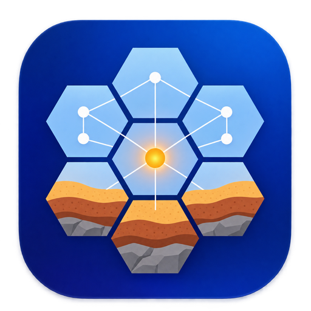

<p align="center"></p>

# TellusHive

TellusHive is an open-source multi-agent system for civil-engineering design, written entirely
in Rust. The engineer chats with a coordinator agent, which hands the work to a team of
specialists that calculate to the chosen standards, check each other's results, draw, write the
calculation report and drive FE programs such as Tellus through MCP.

Its agent harness, `th-hive`, is developed from [DeepSeek Harness](https://github.com/deepseek-ai/deepseek-harness)
(`dsh`, DeepSeek-AI) and ports its **everything-is-a-plugin** architecture to Rust. Like dsh,
TellusHive builds on [Cordis](https://github.com/cordiverse/cordis), whose design is described in
[_A Programming Paradigm for Spatiotemporal Composability_](https://arxiv.org/abs/2608.25512): the
model adapter, the tool registry, the session log and the agent loop are all plugins on one
shared context, and the engineering side of TellusHive is one more bundle of plugins on top.

Documentation: [architecture](docs/architecture.md) · [user guide](docs/guide.md)

## Download

Version 0.1.4 (developer preview), from the [release page](https://github.com/Sompote/TellusHive/releases/tag/v0.1.4):

| System | Download | What it is |
|---|---|---|
| macOS 11 or newer, Apple silicon and Intel | [TellusHive-0.1.4-macos-universal.zip](https://github.com/Sompote/TellusHive/releases/download/v0.1.4/TellusHive-0.1.4-macos-universal.zip) | `TellusHive.app`, one universal program |
| Windows 10 or 11, 64-bit | [TellusHive-0.1.4-windows-x64.zip](https://github.com/Sompote/TellusHive/releases/download/v0.1.4/TellusHive-0.1.4-windows-x64.zip) | `tellushive.exe`, no installer needed |

The programs are not signed by Apple or Microsoft, so the first start needs one extra step. On
macOS, unzip the file, move `TellusHive.app` to Applications, then right-click it and choose
**Open** (or run `xattr -dr com.apple.quarantine /Applications/TellusHive.app` once). On Windows,
unzip the folder and start `tellushive.exe`; if SmartScreen warns, choose **More info → Run
anyway**. The Windows build is cross-compiled on macOS and has not yet been tested on a Windows
computer, so please report what you find.

### What is new in 0.1.4

The geotechnical analyst now runs TellusLEM for slope stability by limit equilibrium, so a slope,
cut or embankment gets its factor of safety by Morgenstern-Price with Bishop and Spencer as
cross-checks and a full search of circular and non-circular slip surfaces, while Tellus confirms
a critical slope by phi-c reduction and gives the deformations. TellusHive finds TellusLEM in
Applications, in its build folder or in its packaged app. Drawings also read better in CAD,
because dimension text now takes the height of the labels beside it instead of about twice that,
and the DXF text styles use Arial (and Tahoma for Thai) rather than the txt.shx shape font, which
CADCraft had to replace on every open. **Stop** now stops at once, including a program
calculation or a script that is running, instead of waiting for it to finish.

The team keeps to the work the engineer asks for, so a slope, excavation or embankment analysis
does not start the BIM modeller or the structural analyst unless a model is asked for. When it
is, the BIM modeller builds the ground as terrain in Aedifex with `add_graded_slope` or
`add_topography`, which needs an Aedifex build with those tools. A team and settings saved by an
earlier version take up new built-in texts and plugin lists on their own, whereas any text or
list you changed is kept, so if you edited an agent yourself, choose **Reset to the default
design office** in step **3 Team** to get the new wording, then add your changes again.

## How to use

1. **Add a model.** Open **Settings** (the gear at the top right) and paste an API key for
   OpenRouter or DeepSeek. Without a key, give an agent the provider `claude-code` or `codex` in
   the Team step, and it runs on your Claude Code or Codex login instead.
2. **Make a project.** On the **Home** page, start from an example, a template or a one-line
   brief. Step **1 Project** holds the description and the notes every agent reads.
3. **Choose the standards.** In step **2 Standards**, import the codes you design to (PDF, text
   or Markdown) and tick the ones this project follows, so agents cite real clauses.
4. **Check the team.** Step **3 Team** shows the coordinator and the specialists. Click an agent
   to set its model, its **Thinking** (off for drafting and BIM, high for checking), its tools
   and its plugins. The arrows show who may delegate to whom.
5. **Connect programs (optional).** Step **4 Plugins** lists the MCP programs found on your
   computer, such as TellusLEM (slope stability), Tellus, Tellus3D, Pondus, Aedifex (buildings and
   terrain) and CADCraft.
6. **Ask for a design.** In the **Design office**, write the request with all the data (geometry,
   loads, materials, soil, standard, deliverables) and press Send. Name every deliverable you
   want, such as drawings, a report or a BIM model, because the coordinator gives work only to
   the specialists the request needs. The panel on the left shows which agents are working and
   what they are doing.
7. **Read the results.** Calculation sheets with PASS/FAIL, drawings (SVG and DXF), the PDF report
   and, when Aedifex was used, the BIM model or terrain in 3D appear beside the chat and in **Output**. Every
   number traces back to its calculation sheet, and the agents' full logs are in the project's
   `sessions/` folder.

Check every design yourself before you use it: the agents can be wrong, and [SAFETY.md](SAFETY.md)
says what they may do on your computer.

## Developer preview

TellusHive is in _developer preview_ and changes quickly. **THERE WILL BE COMPATIBILITY-BREAKING
CHANGES**, including to the session log format and the settings file.

Review the [safety notice](SAFETY.md) before running the project, because its agents can run code
and drive programs on your computer.

## Run

### Run from source

To build it yourself, install [Rust](https://rustup.rs), then run:

```sh
git clone https://github.com/Sompote/TellusHive.git
cd TellusHive
cargo build --release
./target/release/tellushive
```

The last command opens the window. Add a provider key in **Settings**, or set
`OPENROUTER_API_KEY` or `DEEPSEEK_API_KEY` before starting it. Without any key, choose the
provider `claude-code` or `codex` and the agents run on your Claude Code or Codex login instead. The [user guide](docs/guide.md)
explains the workspaces, the team canvas, templates and the engineering programs.

### Other commands

```sh
./target/release/tellushive run --project DIR "Design a ..."   # one turn in the terminal
./target/release/tellushive plugins [--project DIR]            # the plugin tree (like dsh --dump-config)
./target/release/tellushive --mcp --project DIR                # the engineering tools as an MCP server
```

## Development

Start with the [architecture documentation](docs/architecture.md), which maps each part of
`th-hive` to the DeepSeek Harness package it is developed from and shows the turn flow, the tool
pipeline and the session log.

```sh
cargo test --workspace     # 86 tests, no API key needed
```

The harness tests replace the model provider with a scripted adapter, so they cover the step
loop, parallel delegation, retry, compaction, spill, the task board and resuming a session
without any key. New behaviour goes into a plugin that attaches to a documented seam (a tool,
a tool source, a prompt section, a subagent source or a hook) rather than into the loop itself.

## Citation

If you use TellusHive, please also cite DeepSeek Harness, whose architecture its harness follows:

```bibtex
@misc{deepseek-harness2026,
  title={DeepSeek Harness: Everything is a Plugin},
  author={DeepSeek-AI},
  year={2026},
  publisher={GitHub},
  howpublished={\url{https://github.com/deepseek-ai/deepseek-harness}},
}
```

## License

[MIT](LICENSE)

TellusHive is not affiliated with or endorsed by DeepSeek. The DeepSeek Harness licence is
reproduced in [THIRD_PARTY_NOTICES.md](THIRD_PARTY_NOTICES.md).
