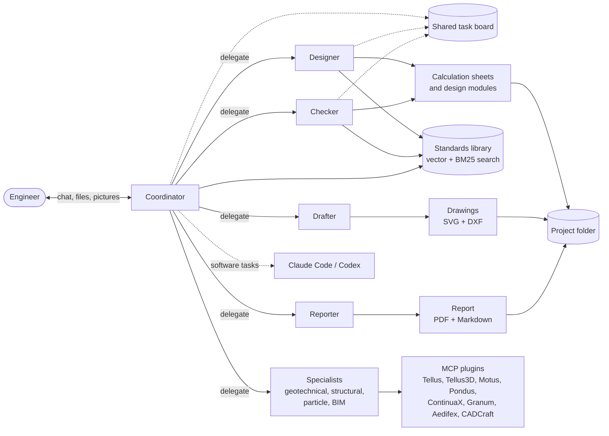
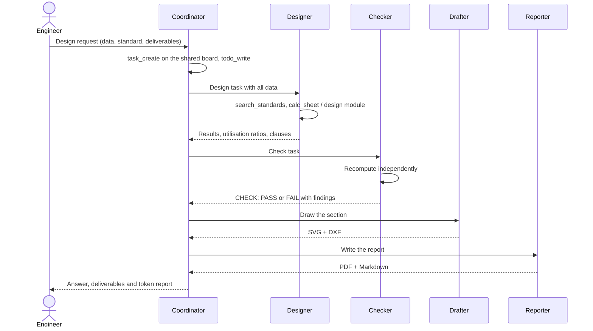
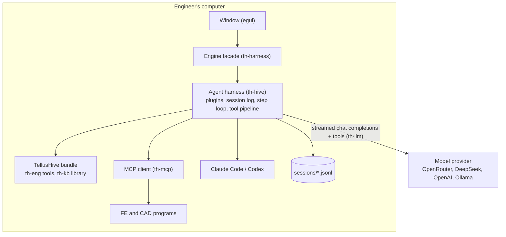

<p align="center"></p>

# TellusHive: an AI design team for civil engineers

TellusHive is a multi-agent system for civil-engineering design, written entirely in Rust. The
engineer chats with a **coordinator** agent, which plans the work and hands it to specialist
agents: the designer calculates to the standards the engineer chose, the checker verifies the
design independently, the drafter makes drawings and the reporter writes the PDF calculation
report. The coordinator can also give programming tasks to **Claude Code** or **Codex**, and
agents drive FE programs such as **Tellus** through MCP.

> **Built on the DeepSeek Harness architecture.** The agent harness of TellusHive, the
> `th-hive` crate, is developed from [DeepSeek Harness](https://github.com/deepseek-ai/deepseek-harness)
> (`dsh`, DeepSeek-AI, MIT licence). It is a Rust port of the dsh design rather than a copy of
> its TypeScript code: everything is a plugin on a shared context, the model sees only what an
> append-only session log records, and every turn runs through the same step loop and guarded
> tool pipeline. The engineering side (tools, standards library, MCP programs, window) comes
> from the earlier Agentic Design application. See [Acknowledgement](#acknowledgement).

## How it works

The engineer talks only to the coordinator, which splits the request into tasks and hands each
task, with all the data it needs, to a specialist. Each specialist runs its own loop of model
calls and tool calls on its own session and returns its answer. Every number an agent reports
must come from a tool result, and every clause it cites must come from the standards library,
so a design can be traced back to its calculation sheet and its source.



A typical design task runs in the order below. The checker recomputes the governing results on
its own instead of trusting the designer, and the coordinator reports a design as final only
after the checker has passed it. Tasks that do not need each other's results, such as two
members or the checker and the drafter, are given out in the same reply and run at the same
time.



Every model call goes through one OpenAI-compatible adapter, so each agent can use its own
provider and model. The window, the harness and the tools all run on the engineer's computer,
and only the model requests leave it.



## The agent harness (th-hive)

`th-hive` follows the architecture of DeepSeek Harness, so its parts map one to one onto the
dsh packages. The table lists each part with the dsh package it is developed from.

| th-hive | What it does | DeepSeek Harness counterpart |
|---|---|---|
| `context` | Plugins provide services on a shared context, wait for the services they inject, and record every registration as an effect that unwinds when they unload | Cordis context, plugins and effects |
| `events` | Typed hook points with the Cordis dispatch modes `emit`, `waterfall` (around-middleware with `next`) and `bail` | Cordis events |
| `session` | The append-only JSONL session log (`turn/*`, `step/*`, `system/message`, `user/message`, `assistant/message`, `tool/call`, `tool/result`, `todo/write`, `compaction/*`), from which the model history is derived | `core/session` |
| `agent_loop` | The turn and step driver with the hooks `agent/pre-step`, `agent/request`, `agent/request-error` and `agent/turn-stopping` | `core/agent-loop` |
| `tools` | The tool registry and its pipeline: `tools/pre-execute`, monotonic guards, `tools/execute`, `tools/post-execute` in model order, `tools/result`; concurrent calls of one reply run together | `core/tools`, tool executor |
| `llm` | The model seam with the `llm/stream` waterfall and the OpenAI-compatible adapter (streamed, DeepSeek reasoning sent back inside a turn) | `llm/llm`, `llm-deepseek` |
| `prompt` | Ordered prompt sections and the `system-prompt/assemble` waterfall | `core/system-prompt` |
| `plugins::compaction` | Prunes old tool results under pressure, then summarises the older history into one logged replacement message | `dsh-compaction-basic` |
| `plugins::guards` | Repeat-tool reminder, continuation of a turn that stopped too early, spill of long outputs to a file | `dsh-repeat-tool-reminder`, `dsh-spill` |
| `plugins::llm` | Retry of rate limits, server errors and broken streams | `llm-retry` |
| `plugins::todo` | `todo_write`, a whole-list todo kept as a durable event | `dsh-tool-todo` |
| `plugins::subagent` | `delegate` and `delegate_parallel`: a child agent on its own session, linked to the parent's | `subagent`, `tool-subagent` |
| `plugins::team_board` | `task_create`, `task_update`, `task_list`: a shared task graph with revisions and no cycles | `agent-team` |

Because the model only sees what the log holds, a conversation can be continued after a
restart, and every request can be rebuilt from its session file. The coordinator's session is
the chat itself, and each delegated task gets its own session file beside it. The system prompt
stays the same while the project and team do not change, so providers that cache prompt
prefixes, such as DeepSeek, reuse most of each request (5,248 of 5,457 prompt tokens in a
recorded call).

TellusHive itself is a bundle of plugins mounted after the hive base bundle, in the same way a
dsh profile stacks bundles. `tellushive plugins` prints the whole tree with each plugin's state,
like `dsh --dump-config`:

```text
- hive-core                   active   agents, agentLoop, llm, tools, systemPrompt, sessions
- hive-llm-openai-compatible  active   DeepSeek, OpenRouter, Ollama, OpenAI (streamed chat completions)
- hive-llm-retry              active   3 retries on 408/429/5xx and transport errors
- hive-compaction             active   prune, then summarise above ~90k tokens; keeps the last 8 nodes
- hive-repeat-tool-reminder   active   advisory reminder at [3, 5, 8] identical calls
- hive-continuation-guard     active   agent/turn-stopping: up to 2 nudges per turn
- hive-spill                  active   outputs over 12000 characters go to a file
- hive-tool-todo              active   todo_write + todo/write events
- hive-subagent               active   delegate / delegate_parallel, depth ≤ 3
- hive-team-board             active   task_create / task_update / task_list, shared by the agent tree
- tellushive-domain           active   settings, team, project, standards library, programs, skills
- tellushive-tools            active   14 engineering tools
- tellushive-mcp              active   each agent's MCP programs as tools (gateway above 128 tools)
- tellushive-team             active   team members as subagents along the canvas arrows; Claude Code / Codex
- tellushive-prompt           active   role, project, standards, team, skills, programs, rules
- tellushive-tool-cap         active   at most 128 tools per request
- tellushive-ui               active   session and stream events to the chat
```

The `harness` block of `settings.json` holds the base bundle's settings (compaction budget,
parallel calls, spill size, repeat thresholds, retries) and `disabled_plugins`, which leaves
named plugins out of the tree, as a dsh profile patch does.

Some parts of DeepSeek Harness are deliberately not ported. The `dsh_session_log` extension,
which uploads session logs to DeepSeek, is left out so that logs stay on the engineer's
computer, and the web client, sandboxing and the approval prompt are not part of TellusHive,
whose pipeline has the `ask` decision and `approval` service but no window that answers it yet.

## Workspace

| Crate | What it does |
|---|---|
| `crates/llm` (`th-llm`) | OpenAI-compatible chat client with streamed replies, tool calls, image inputs, reasoning pass-back and embeddings. It works with DeepSeek, OpenRouter, Ollama, OpenAI or any compatible gateway. |
| `crates/mcp` (`th-mcp`) | Model Context Protocol client over stdio and Streamable HTTP, plus a small stdio server. |
| `crates/kb` (`th-kb`) | The standards library: a local vector database with clause-aware chunking of PDF, text and Markdown. Search fuses vector and BM25 results and boosts exact clause numbers. |
| `crates/eng` (`th-eng`) | The engineering engine: a traceable calculation sheet with an expression evaluator, verified design modules, 2D drawings (SVG and DXF R12) and PDF/Markdown reports. |
| `crates/hive` (`th-hive`) | The agent harness developed from DeepSeek Harness (see above). It knows nothing about engineering. |
| `crates/harness` (`th-harness`) | Settings, the agent team, skills, MCP programs, projects and the built-in tools, mounted on th-hive as the TellusHive bundle (`bundle.rs`), with the engine facade the window uses (`engine.rs`). |
| `app` (`tellushive`) | The egui window in the Tellus3D look. It also runs the headless `run` command, `plugins` and the `--mcp` server. |

## Build and run

```sh
cargo build --release
./target/release/tellushive                       # the window
./target/release/tellushive run --project ~/Documents/TellusHive/demo "Design a ..."
./target/release/tellushive plugins [--project DIR]   # the harness plugin tree
./target/release/tellushive --mcp --project DIR       # tools as an MCP server
cargo test --workspace                            # 80 tests, no API key needed
```

Add a provider key in **Settings**, or set `OPENROUTER_API_KEY` or `DEEPSEEK_API_KEY`. The
harness tests use a scripted model in place of a provider, so they cover the step loop,
parallel delegation, retry, compaction, spill, the task board and resuming a session without
any key. DeepSeek's API cannot read images, so pictures attached to the chat are first described
by the **Vision** model (an OpenRouter key is the simplest route), and Claude Code reads them
when no vision model is set up.

## Workspaces in the window

- **Design** has the project explorer on the left (description, notes for every agent, chosen
  standards, team, artifacts), the chat in the middle and the artifact viewer on the right. The
  viewer shows calculation sheets with PASS/FAIL, drawings, reports and pictures, and files can
  be attached with the button or dropped onto the window. While an agent writes, the panel of
  agents at work shows its text as it streams.
- **Team** shows the agents as nodes on a canvas. Each agent has its own role, instructions,
  provider and model, built-in tools, skills, plugins, delegation targets, and a switch for
  whether it may use Claude Code or Codex. Teams are saved as JSON in the data folder.
- **Standards** imports standards (PDF, txt, md) into the vector library and sets which ones
  the project follows. You can add office rules as searchable notes and test a search there.
- **Plugins** manages MCP servers. Tellus and Tellus3D are added automatically when their
  programs are found, and any stdio program or HTTP endpoint can be added and connected later.
- **Settings** holds the providers and keys, the default and vision models, the embedding
  model, Claude Code and Codex, the skill folders, the projects folder and the theme.

## Token use

The window counts tokens while the agents work. The top bar shows the running total of the task
next to the timer, the chat shows the model calls and the tokens in and out so far, and the
status bar shows the project's total. When a task ends, a card in the chat reports whether it
finished, was stopped or failed, how long it took and the totals, and it opens into a table by
agent and model with each agent's share. The headless `run` command prints the same report. The
counts cover the agents' model calls only, so picture descriptions by the vision model,
embeddings, compaction summaries and work done inside Claude Code or Codex are not included, and
no cost is shown because the app holds no prices. Each `assistant/message` in the session log
also records the prompt tokens the provider served from its cache.

## Templates

A template saves the whole set-up of the agentic system under a name, so a new project can start
from it. It holds the team (each agent's role, instructions, model, tools, skills, plugins and
delegation links), the chosen standards, the project description and notes, the default and
vision models, the plugins the team uses and the skill folders. API keys are never saved, and
plugin environment values and HTTP headers are blanked, while the chat and the outputs stay
with their project. Save a template in the **Project** step (or from the project menu), and
start a project from it, export it or delete it on the **Home** page, where **Import
template…** reads a template file from another computer. Plugins missing there are added but
switched off until their program is found, and standards missing from the library are listed
for import.

## Skills and plugins

A skill is a folder that holds a `SKILL.md` (front matter with `name` and `description`) and its
reference files. This is the Claude skills format, so `~/.claude/skills` is scanned by default.
An agent sees the one-line description of each skill it is equipped with and loads the full text
with `read_skill`. Plugins are MCP servers, and an agent equipped with a plugin sees that
plugin's tools as `<plugin>__<tool>`.

## The Tellus family and other programs

Each program's MCP server (`--mcp`) is added as a plugin automatically. The finder looks at the
installed app and the build folders and uses the newest copy, and "Find installed programs
again" in step 4 repeats the search after an install.

| Plugin | Program | Tools (10 Nov 2026) | Agent |
|---|---|---:|---|
| `tellus` | Tellus 2D geotechnical FE | 37 | Geotechnical analyst |
| `tellus3d` | Tellus3D 3D geotechnical FE | 31 | Geotechnical analyst |
| `motus` | Motus 1-D site response | 26 | Geotechnical analyst |
| `pondus` | Pondus structural analysis and design | 47 | Structural analyst |
| `continuax` | ContinuaX structural FE | 34 | Structural analyst |
| `granum` | Granum DEM | 33 | Particle modeller |
| `granumfl` | GranumFL DEM-SPH | 53 | Particle modeller |
| `aedifex` | Aedifex BIM modeller | 50 | BIM modeller |
| `cadcraft` | CADCraft CAD | 15 | Drafter, BIM modeller |

The programs are split across specialist agents because providers accept at most 128 tools per
request and every tool description is sent with every model call. In th-hive the programs of an
agent are a per-agent tool source, so when an agent's tools would exceed 128 the largest
plugins are reached through two gateway tools instead of being listed one by one:
`plugin_tools` lists a plugin's tools or gives one tool's argument schema, and `plugin_call`
runs it, so no tool is lost. The coordinator holds no plugins, because it delegates the analyses
to the specialists.

## CADCraft

Every drawing is saved as SVG (screen and report), DXF R12 (CAD, true scale) and JSON. The
viewer's **Open in CADCraft** button loads the DXF into the CADCraft window through CADCraft's
MCP bridge (`cadcraft-cli mcp --connect 127.0.0.1:7979 --lazy --launch`), starting CADCraft when
it is not running, so quit CADCraft first if it is already open without its control port. The
Drafter is equipped with the `cadcraft` plugin, so it can also open drawings in CADCraft and
edit them with AutoCAD-style commands when the engineer asks. In the DXF, pattern hatches sit on
their own grey `HATCH` layer and black or dark-grey ink uses ACI colour 7, so drawings read on
CAD's dark screen and print black.

## Data locations

- `~/Library/Application Support/TellusHive/`: `settings.json` (owner-only, holds keys and the
  `harness` block), `teams/`, `templates/`, `standards/` (the vector library), `skills/`.
- `~/Documents/TellusHive/<project>/`: `project.json`, `attachments/`, `calcs/`, `drawings/`,
  `reports/`, `images/`, `work/`, `chat.json` (the transcript shown in the window) and
  `sessions/`. The `sessions/` folder holds one JSONL log per agent session, the pointer
  `current` to the coordinator session the chat continues, and `spill/` for long tool outputs.
  "Clear the conversation" starts a new session and keeps the old files.

A project made with the earlier Agentic Design app opens normally, but its conversation history
in `chat.json` is not carried over into a session, so the agents start that project's chat
afresh.

## Acknowledgement

The agent harness of TellusHive is developed from **DeepSeek Harness** by DeepSeek-AI
(<https://github.com/deepseek-ai/deepseek-harness>), as its architecture documentation
describes it. DeepSeek Harness runs on the Cordis plugin framework
(<https://github.com/cordiverse/cordis>), whose design is described in *A Programming Paradigm
for Spatiotemporal Composability* (arXiv:2608.25512), and th-hive ports that framework's
plugin, service and effect model as well. DeepSeek Harness is released under the MIT licence, and its notice is
reproduced in [THIRD_PARTY_NOTICES.md](THIRD_PARTY_NOTICES.md). TellusHive is not affiliated
with or endorsed by DeepSeek.

```bibtex
@misc{deepseek-harness2026,
  title={DeepSeek Harness: Everything is a Plugin},
  author={DeepSeek-AI},
  year={2026},
  publisher={GitHub},
  howpublished={\url{https://github.com/deepseek-ai/deepseek-harness}},
}
```

## Licence

MIT.
