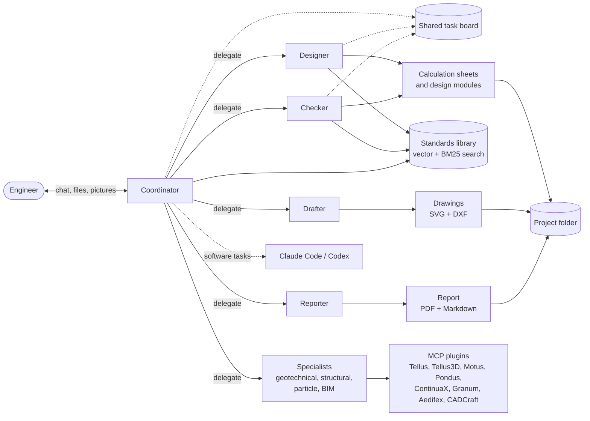
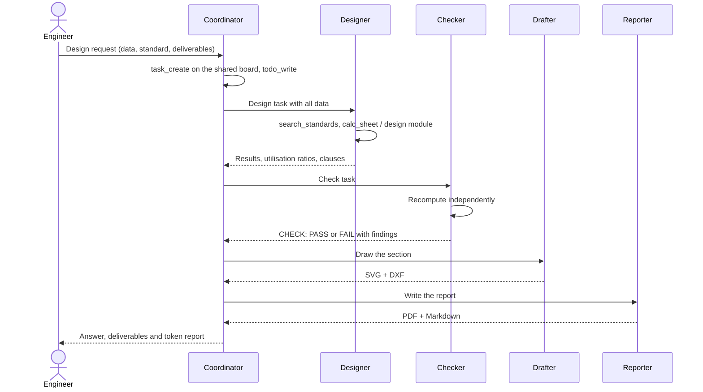
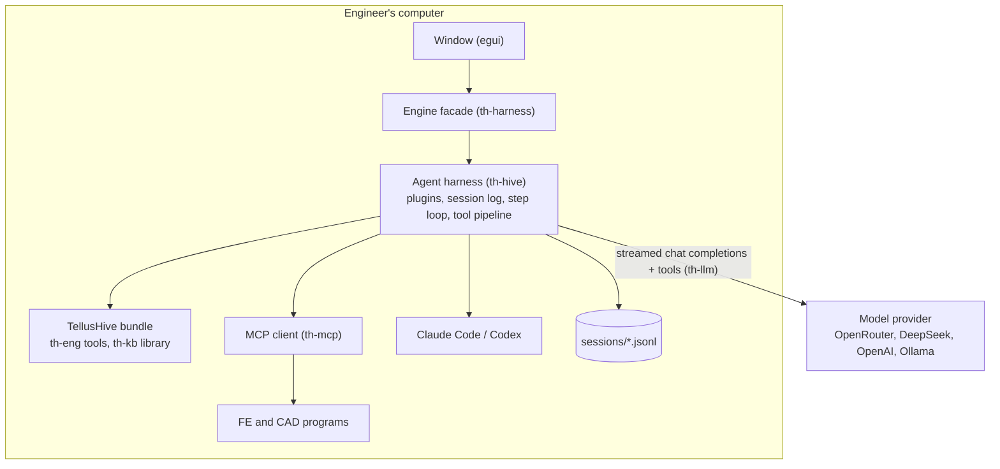

# TellusHive architecture

This page describes how TellusHive is put together: how a design task flows through the agents,
the agent harness `th-hive` that is developed from DeepSeek Harness, and the crates of the
workspace. Read it before changing anything under `crates/hive` or `crates/harness`.

## How it works

The engineer talks only to the coordinator, which splits the request into tasks and hands each
task, with all the data it needs, to a specialist. Each specialist runs its own loop of model
calls and tool calls on its own session and returns its answer. Every number an agent reports
must come from a tool result, and every clause it cites must come from the standards library,
so a design can be traced back to its calculation sheet and its source.



A typical design task runs in the order below. The checker recomputes the governing results on
its own instead of trusting the designer, and the coordinator reports a design as final only
after the checker has passed it. Tasks that do not need each other's results, such as two
members or the checker and the drafter, are given out in the same reply and run at the same
time.



Every model call goes through one OpenAI-compatible adapter, so each agent can use its own
provider and model. The window, the harness and the tools all run on the engineer's computer,
and only the model requests leave it.



## The agent harness (th-hive)

`th-hive` follows the architecture of DeepSeek Harness, so its parts map one to one onto the
dsh packages. The table lists each part with the dsh package it is developed from.

| th-hive | What it does | DeepSeek Harness counterpart |
|---|---|---|
| `context` | Plugins provide services on a shared context, wait for the services they inject, and record every registration as an effect that unwinds when they unload | Cordis context, plugins and effects |
| `events` | Typed hook points with the Cordis dispatch modes `emit`, `waterfall` (around-middleware with `next`) and `bail` | Cordis events |
| `session` | The append-only JSONL session log (`turn/*`, `step/*`, `system/message`, `user/message`, `assistant/message`, `tool/call`, `tool/result`, `todo/write`, `compaction/*`), from which the model history is derived | `core/session` |
| `agent_loop` | The turn and step driver with the hooks `agent/pre-step`, `agent/request`, `agent/request-error` and `agent/turn-stopping` | `core/agent-loop` |
| `tools` | The tool registry and its pipeline: `tools/pre-execute`, monotonic guards, `tools/execute`, `tools/post-execute` in model order, `tools/result`; concurrent calls of one reply run together | `core/tools`, tool executor |
| `llm` | The model seam with the `llm/stream` waterfall and the OpenAI-compatible adapter (streamed, DeepSeek reasoning sent back inside a turn) | `llm/llm`, `llm-deepseek` |
| `prompt` | Ordered prompt sections and the `system-prompt/assemble` waterfall | `core/system-prompt` |
| `plugins::compaction` | Prunes old tool results under pressure, then summarises the older history into one logged replacement message | `dsh-compaction-basic` |
| `plugins::guards` | Repeat-tool reminder, continuation of a turn that stopped too early, spill of long outputs to a file | `dsh-repeat-tool-reminder`, `dsh-spill` |
| `plugins::llm` | Retry of rate limits, server errors and broken streams | `llm-retry` |
| `plugins::todo` | `todo_write`, a whole-list todo kept as a durable event | `dsh-tool-todo` |
| `plugins::subagent` | `delegate` and `delegate_parallel`: a child agent on its own session, linked to the parent's | `subagent`, `tool-subagent` |
| `plugins::team_board` | `task_create`, `task_update`, `task_list`: a shared task graph with revisions and no cycles | `agent-team` |

Because the model only sees what the log holds, a conversation can be continued after a
restart, and every request can be rebuilt from its session file. The coordinator's session is
the chat itself, and each delegated task gets its own session file beside it. The system prompt
stays the same while the project and team do not change, so providers that cache prompt
prefixes, such as DeepSeek, reuse most of each request (5,248 of 5,457 prompt tokens in a
recorded call).

TellusHive itself is a bundle of plugins mounted after the hive base bundle, in the same way a
dsh profile stacks bundles. `tellushive plugins` prints the whole tree with each plugin's state,
like `dsh --dump-config`:

```text
- hive-core                   active   agents, agentLoop, llm, tools, systemPrompt, sessions
- hive-llm-openai-compatible  active   DeepSeek, OpenRouter, Ollama, OpenAI (streamed chat completions)
- hive-llm-retry              active   3 retries on 408/429/5xx and transport errors
- hive-compaction             active   prune, then summarise above ~90k tokens; keeps the last 8 nodes
- hive-repeat-tool-reminder   active   advisory reminder at [3, 5, 8] identical calls
- hive-continuation-guard     active   agent/turn-stopping: up to 2 nudges per turn
- hive-spill                  active   outputs over 12000 characters go to a file
- hive-tool-todo              active   todo_write + todo/write events
- hive-subagent               active   delegate / delegate_parallel, depth ≤ 3
- hive-team-board             active   task_create / task_update / task_list, shared by the agent tree
- tellushive-domain           active   settings, team, project, standards library, programs, skills
- tellushive-tools            active   14 engineering tools
- tellushive-mcp              active   each agent's MCP programs as tools (gateway above 128 tools)
- tellushive-team             active   team members as subagents along the canvas arrows; Claude Code / Codex
- tellushive-prompt           active   role, project, standards, team, skills, programs, rules
- tellushive-tool-cap         active   at most 128 tools per request
- tellushive-ui               active   session and stream events to the chat
- tellushive-cli-models       active   providers claude-code and codex: the coding agent runs as the model, with this agent's tools over MCP
```

The `harness` block of `settings.json` holds the base bundle's settings (compaction budget,
parallel calls, spill size, repeat thresholds, retries) and `disabled_plugins`, which leaves
named plugins out of the tree, as a dsh profile patch does.

Some parts of DeepSeek Harness are deliberately not ported. The `dsh_session_log` extension,
which uploads session logs to DeepSeek, is left out so that logs stay on the engineer's
computer, and the web client, sandboxing and the approval prompt are not part of TellusHive,
whose pipeline has the `ask` decision and `approval` service but no window that answers it yet.

## Workspace

| Crate | What it does |
|---|---|
| `crates/llm` (`th-llm`) | OpenAI-compatible chat client with streamed replies, tool calls, image inputs, reasoning pass-back and embeddings. It works with DeepSeek, OpenRouter, Ollama, OpenAI or any compatible gateway. |
| `crates/mcp` (`th-mcp`) | Model Context Protocol client over stdio and Streamable HTTP, plus a small stdio server. |
| `crates/kb` (`th-kb`) | The standards library: a local vector database with clause-aware chunking of PDF, text and Markdown. Search fuses vector and BM25 results and boosts exact clause numbers. |
| `crates/eng` (`th-eng`) | The engineering engine: a traceable calculation sheet with an expression evaluator, verified design modules, 2D drawings (SVG and DXF R12) and PDF/Markdown reports. |
| `crates/hive` (`th-hive`) | The agent harness developed from DeepSeek Harness (see [The agent harness](#the-agent-harness-th-hive)). It knows nothing about engineering. |
| `crates/harness` (`th-harness`) | Settings, the agent team, skills, MCP programs, projects and the built-in tools, mounted on th-hive as the TellusHive bundle (`bundle.rs`), with the engine facade the window uses (`engine.rs`). |
| `app` (`tellushive`) | The egui window in the Tellus3D look. It also runs the headless `run` command, `plugins` and the `--mcp` server. |
