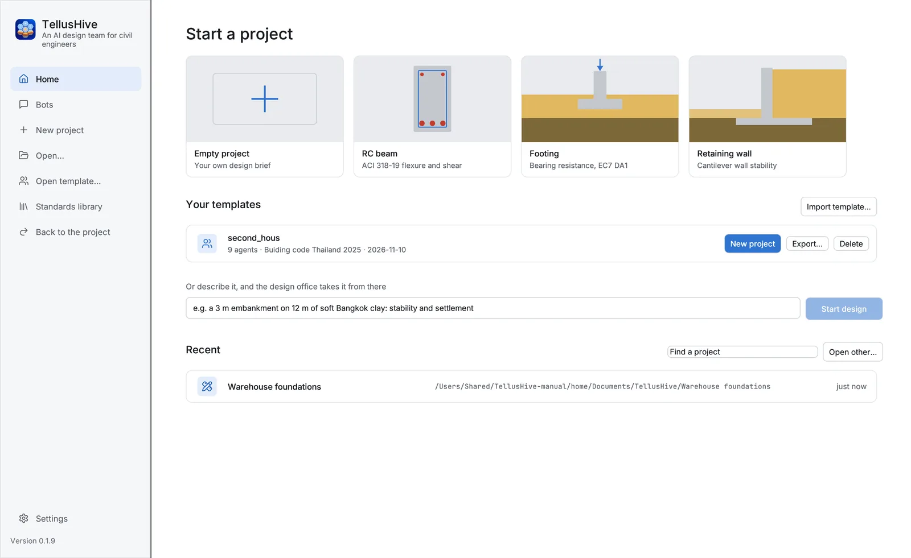
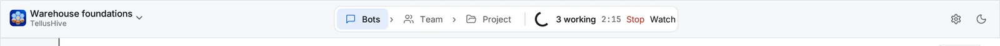

# 1. Getting started

This chapter takes you from the download to a first answer from a bot. It covers installing the program, giving it a language model to work with, and the parts of the window you will use every day.

## Install TellusHive

Download the file for your computer from the [release page](https://github.com/Sompote/TellusHive/releases/latest). The macOS download is `TellusHive-0.2.2-macos-universal.zip`, which runs on both Apple silicon and Intel Macs with macOS 11 or newer, and the Windows download is `TellusHive-0.2.2-windows-x64.zip` for 64-bit Windows 10 or 11. Neither program is signed by Apple or Microsoft, so the first start needs one extra step.

On macOS, unzip the file and move `TellusHive.app` to the Applications folder. Right-click the app and choose **Open** the first time, because a double-click on an unsigned app only shows a warning. If macOS still refuses, run `xattr -dr com.apple.quarantine /Applications/TellusHive.app` once in Terminal. On Windows, unzip the folder and start `tellushive.exe`, and if SmartScreen warns, choose **More info** and then **Run anyway**. From 0.2.1 the Windows build is made and tested on Windows, and it needs no Visual C++ runtime.

To build TellusHive from source instead, install [Rust](https://rustup.rs), then run `git clone https://github.com/Sompote/TellusHive.git`, `cd TellusHive`, `cargo build --release` and `./target/release/tellushive`.

## The first start

TellusHive opens on the **Home** page. On the first start it makes a project called **First project** in your projects folder (`~/Documents/TellusHive` unless you change it), adds the design office team with its nine agents, and looks for the engineering programs it knows, such as Tellus, Pondus and Aedifex, so they are ready as plugins.

The Home page has four parts. **Start a project** offers an empty project and three worked examples (an RC beam to ACI 318-19, a pad footing to EC7 DA1 and a cantilever retaining wall), so you can see the team work before you give it your own job. **Your templates** lists the set-ups you have saved, **Or describe it** takes a one-line brief and starts the design office on it, and **Recent** reopens the projects you worked on. The rail on the left also leads to **Bots**, **New project**, **Open…**, **Open template…**, the **Standards library** and **Settings**.

## Add a model

The agents need a language model, so give TellusHive one before you ask for a design. Open **Settings** (the gear at the top right of the window, or **Settings** at the bottom of the Home rail) and choose **Models**. There are three ways to start, and you can mix them later.

1. **An API key.** The default provider is OpenRouter with the model `deepseek/deepseek-v4.1-flash-1017`, which uses tools and reads images. Paste your OpenRouter key into **API key** under **Provider: openrouter**, or set the environment variable `OPENROUTER_API_KEY` before you start TellusHive. A DeepSeek key works the same way under **Provider: deepseek** (`DEEPSEEK_API_KEY`).
2. **Your Claude or ChatGPT subscription.** If Claude Code or Codex is installed and signed in on this computer, choose the provider `claude-code` or `codex` for a bot or an agent, and it runs on your subscription with no API key.
3. **Your own model.** Point the `vllm` provider at a vLLM server on this computer, or `vllm-vast` at one on a rented GPU, or use `ollama` for a local Ollama server.

[Chapter 7](07-models-and-providers.md) explains every provider and setting. A key typed in **Settings** is saved in `settings.json` in the data folder, which only your user account can read.

## How the window is laid out

The bar at the top of the window shows the open project on the left, with a menu to switch projects, and the three layers of the program in the middle: **Bots**, **Team** and **Project**. The gear opens **Settings** and the moon switches between the light and dark theme. While the agents work, the bar also shows how many are working, the elapsed time, **Stop** and **Watch**, which opens the Design office where the team's task is running.

The three layers build on each other. A **bot** is the one you talk to, a project manager with its own name, face and character. A **team** is the design office a bot can call, led by its coordinator and staffed by specialist agents. A **project** is what they work on, a folder with its description, notes, standards, plugins and results. You can work at any layer: talk to a bot in **Bots**, talk to a whole team in the **Design office**, or set up the team and the project in **Team** and **Project**. The status bar at the bottom shows how many standards the project follows, how many agents the team has and how many plugins are connected.

## Your first design

Open **Bots**, choose a bot in the rail on the left, and write your request in the box at the bottom, for example "Design a pile foundation in Bangkok clay for a load of 10,000 kN". Press Enter to send it. The bot reads the request, may ask you for missing data such as the soil profile or the load basis, and then plans the work, calls its team if it has one, and reports back with the clauses it relied on. Calculation sheets, drawings and reports appear in the chat as they are made, and a click on a file opens it. [Chapter 2](02-bots.md) explains bots in detail.

Give the agents all the data you have: geometry, loads and whether they are factored, materials, the soil profile with groundwater, the standard to follow and the deliverables you want. The coordinator gives work only to the specialists the request needs, so name every deliverable, such as drawings, a report or a BIM model, if you want it.
