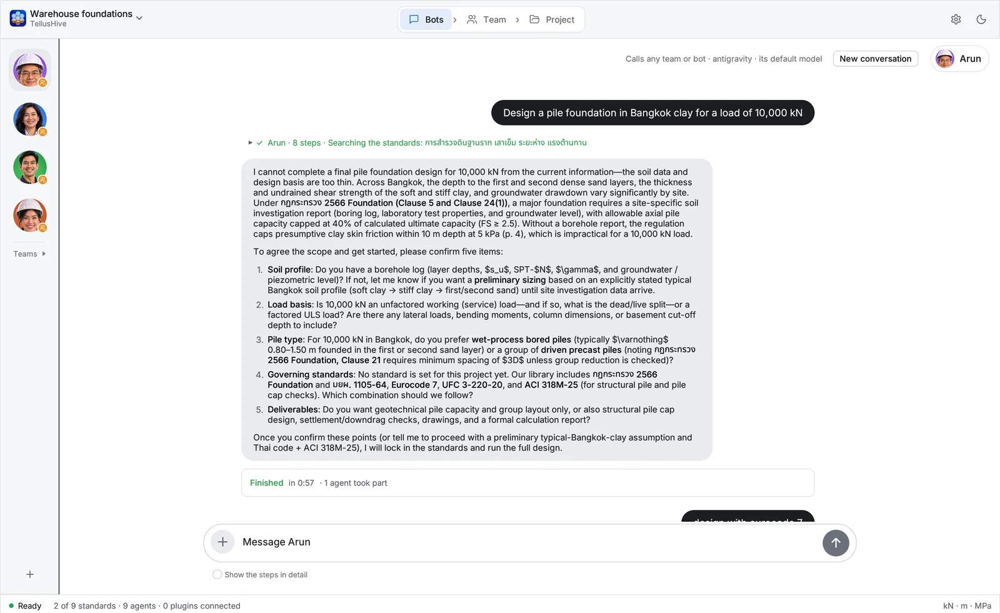
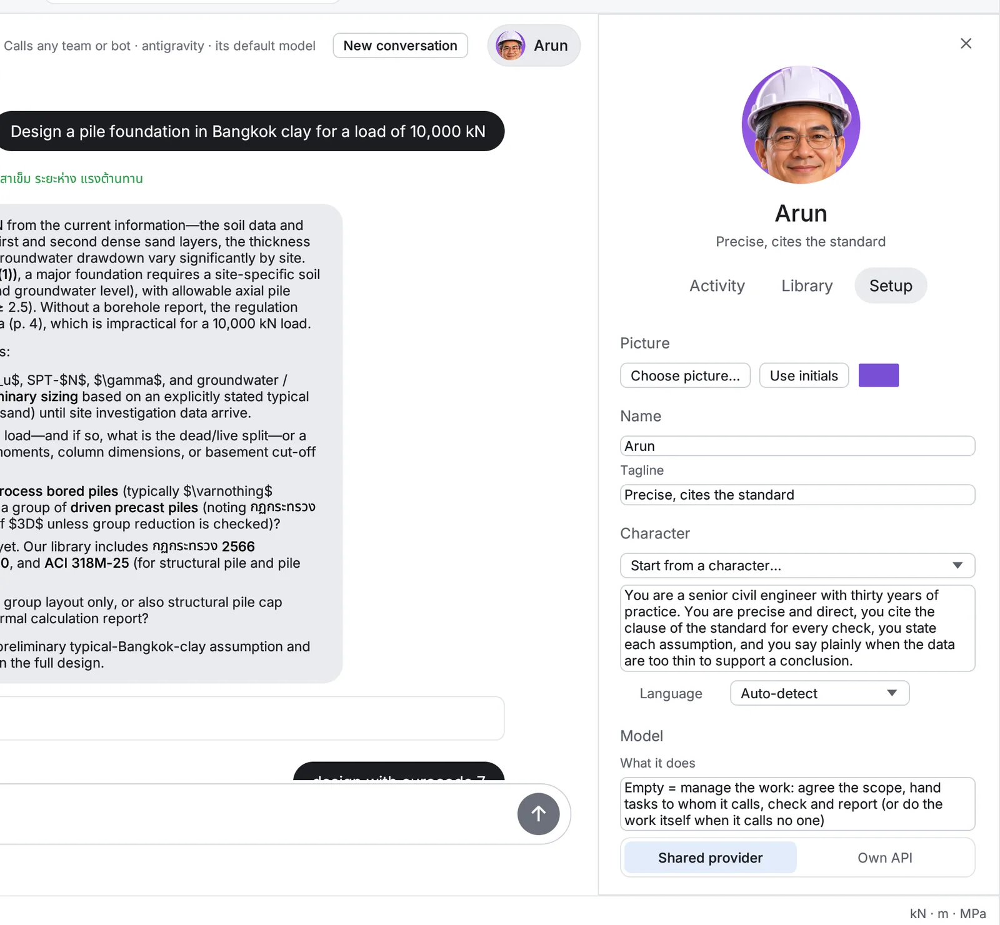

# 2. Bots

A bot is your project manager. You talk to it in a chat the way you would message a colleague, and it agrees the scope with you, does small jobs itself, hands larger ones to the teams and bots it may call, checks what comes back and reports to you. Each bot has its own name, picture, character, reply language, model and conversation, and it carries its own bundle of standards and plugins that it sets its project up with. This chapter explains how to make a bot, how to set it up, and how to work with it.

## The Bots workspace

Click **Bots** in the top bar. The rail on the left shows your bots as round pictures, with a small team mark on those that call other bots or teams and a pulsing dot on one that is working, and below them **Teams**, which opens into the saved teams so you can also talk to a team directly. The chat with the chosen bot fills the middle. At the top right of the chat, the line of grey text says what the bot calls and which model it runs on, **New conversation** clears the chat, and the chip with the bot's picture and name opens its profile on the right.

## Make a bot

Click **+** at the bottom of the rail. TellusHive offers two kinds of bot, and you can change everything about either one later.

- **New bot that works alone** makes one agent with its own model and tools. It answers and calculates itself, and you can let it call other bots later.
- **New bot that calls a team** makes a project manager that hands the work to a team, led by that team's coordinator. It starts with the first saved team, usually the **Design office**.

The new bot opens with its profile on the **Setup** tab, so you can name it and shape it straight away.

## The profile

Click the chip with the bot's name at the top right of the chat to open the profile, and click it again or the **×** to close it. The profile has three tabs.

- **Activity** shows what is happening now. **Now** says what the bot and its agents are doing during a task, **Who works** draws the bot with the teams and bots it calls, **Project** names the folder the bot works in, with **Show in Finder** and **New conversation**, and **Usage** totals the tokens the bot has used.
- **Library** lists the files of the bot's project by kind, calculations, drawings, reports, pictures, attachments and work files, and a click opens a file.
- **Setup** holds everything that makes the bot what it is, described below.

## Setup, from top to bottom

**Picture.** **Choose picture…** takes a PNG, JPEG or WebP file and crops it to its centre square, and **Use initials** goes back to the initials on a coloured circle. The colour swatch sets the colour of the initials and of the dot beside the bot's replies.

**Name and Tagline.** The name is how the bot introduces itself and how other agents and bots address it. The tagline is the one line shown under the name in the rail and the profile, such as "Precise, cites the standard".

**Character.** The text box describes who the bot is and how it talks: its background, tone and habits. **Start from a character…** fills it from five ready-made characters, a senior engineer who cites the standard, a friendly tutor who explains step by step, a site engineer with short practical answers, an independent checker who recomputes before trusting, and a research professor who flags weak evidence. **Language** sets the reply language: **Auto-detect** answers in the language you write in, or choose English, Thai, Japanese or Chinese to fix it.

**Model.** **What it does** holds the bot's work instructions. Left empty, a bot that calls others manages the work (it agrees the scope, hands tasks out, checks and reports) and a bot that calls no one does the work itself. Below it, **Shared provider** runs the bot on one of the providers in **Settings › Models**, with its **Provider**, **Model**, **Thinking** (off, low, medium or high), **Temperature** and **Max turns**. **Own API** gives the bot its own model API instead, with its own **Base URL**, **API key** and **Model**, and **List models** asks the API which models it serves, which also checks the address and the key. A bot's own key affects only that bot, and it is kept in the bot's file, readable only by you.

**Tools and skills.** **All tools** gives the bot every built-in tool (calculation sheets, design modules, Python, drawings, files, the standards library and the rest), or switch it off to tick only some. **All skills** does the same for the skills in your skill folders. **May use Claude Code / Codex** lets the bot hand a programming task to Claude Code or Codex as a worker.

**Calls.** This decides whom the bot hands work to. With **May call any team or bot** switched on, the bot chooses for each task among all saved teams, which join through their coordinator, and all other bots. Switch it off to tick the teams and bots yourself. A bot with nothing to call works alone.

**Standards and plugins.** This is the bot's bundle. The bot sets its project up with these standards and plugins, so every agent it calls cites these standards and can drive these programs, and the bot's choice replaces the project's own. The standards come from the library in **Settings › Standards library** ([chapter 5](05-standards-library.md)), and the plugins from **Settings › Plugins & MCP** ([chapter 6](06-plugins-and-mcp.md)). Each plugin a bot drives starts when the bot runs, so switch on only those it needs, and the teams it calls use their own.

**Project.** A new bot works in its own folder inside the bot's data folder. **Use the open project** points it at the project open in the window, **Choose project…** at any project folder, and **Use its own folder** takes it back. The project can change only while the bot is idle. At the bottom of Setup, **Delete bot** removes the bot with its conversation and its own folder, while a linked project is kept.

## Working in the chat

Write in the box at the bottom and press Enter to send, or Shift+Enter for a new line. The **+** beside the box attaches files such as drawings, borehole logs, photos or PDFs, and you can also drop files onto the window. Each file is copied into the project's `attachments/` folder, and the bot reads text and PDFs and looks at pictures, using the vision model when its own model cannot see images.

While the bot works, the top bar shows how many agents are working, the time and **Stop**, and the chat shows what each agent is doing. The bot's replies stream in as it writes, and a reply that ran several steps starts with a folded line, such as "Arun · 8 steps · Searching the standards", which opens into the steps. **Show the steps in detail** under the box adds the tool calls, the agents' reasoning and the token counts to the chat. When a task ends, a card says whether it finished, was stopped or failed, how long it took and how many agents took part.

Calculation sheets, drawings, reports and pictures appear in the chat as the agents save them, and a click opens them. A link in a reply, such as `reports/Embankment_3m_Bangkok_clay_stability.pdf`, opens the file from the project folder in your default app, and a web link opens in the browser. For safety the chat opens only files inside the project folder, and it does not open programs or scripts. Formulas that a bot writes in LaTeX, such as `$\phi M_n \ge M_u$` in a sentence or `$$\frac{wL^2}{8}$$` on a line of its own, are shown with their symbols, raised and lowered scripts, fractions and roots, so a calculation reads as it would on paper.

**New conversation** in the chat header clears the chat and starts a fresh conversation, after you confirm. The bot forgets the old conversation, its standards, plugins, character and files stay, and the old conversation is kept in the project's `sessions/` folder. The button is greyed out while the bot works, so stop the task first.

## Good practice

Give the bot one clear request with all the data, and name the deliverables you want. Pick the governing standards for the project before a real design, because without them the agents search the whole library and may mix codes. A bot that calls a team is the right choice for full designs with drawings and reports, whereas a bot that works alone answers quick questions faster and at lower cost.
