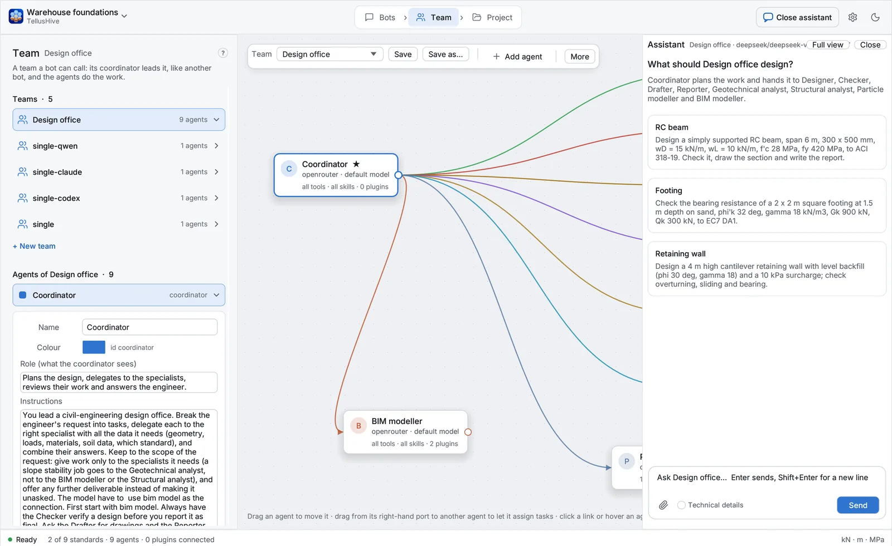
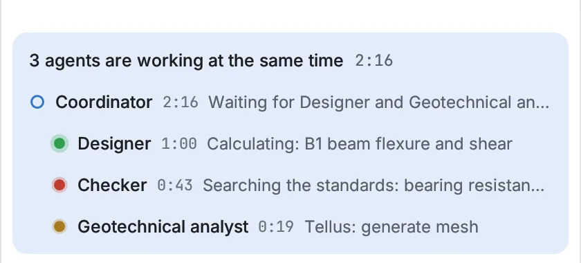

# 3. Teams and agents

A team is a design office of AI agents. One agent is the coordinator, who leads the team, plans the work and hands each task to the specialist that fits it, and the others are the specialists, each with one discipline, its own model, its own tools and its own programs. A bot that calls a team talks to its coordinator, and you can also talk to a team directly in the **Design office**. This chapter explains the built-in team, how to change it, and every setting of an agent.

## The built-in design office

TellusHive starts with a team called **Design office** with nine agents. Each specialist has a default time limit for one delegated task, so a stuck step cannot hold the run up for ever.

| Agent | What it does | Programs it drives | Time limit |
|---|---|---|---|
| Coordinator | Plans the design, delegates to the specialists, reviews their work and answers you | none, it delegates | none |
| Designer | Looks up the clauses of the chosen standard and writes traceable calculations | design modules, calculation sheets | 20 min |
| Checker | Recomputes the key results independently and returns pass or a list of errors | calculation sheets | 20 min |
| Drafter | Draws sections, plans and details as SVG and DXF | CADCraft | 20 min |
| Reporter | Assembles the calculation report from the saved calculations and drawings | none | 20 min |
| Geotechnical analyst | Slope stability, finite element analysis of excavations, embankments and foundations, site response | TellusLEM, Tellus, Tellus3D, Motus | 90 min |
| Structural analyst | Frames, walls and slabs with member design, and continuum finite elements | Pondus, ContinuaX | 90 min |
| Particle modeller | Discrete element and grain-water simulations | Granum, GranumFL | 90 min |
| BIM modeller | Builds the BIM model and terrain from the design | Aedifex, CADCraft | 30 min |

The team keeps to the work you ask for, so a slope analysis does not start the BIM modeller unless you ask for a model. The checker reports all its findings in one reply, the coordinator sends them back to the designer in one revision task, and after at most two revision rounds the coordinator asks you instead of looping.

## The Team workspace

Click **Team** in the top bar. The panel on the left lists the saved teams under **Teams**, with **+ New team**, and the agents of the chosen team below, where a click on an agent opens its settings. The canvas in the middle draws the team as a graph: each agent is a card with its provider, model, tools, skills and plugins, the coordinator carries a star, and each arrow means one agent may hand tasks to another.

The bar above the canvas holds the team menu, **Save**, **Save as…**, **Add agent** and **More**, which has **Rename team…**, **Delete team…**, **New team…** and **Reset to the default design office**. The reset brings back the built-in wording after an update, so use it if you have not changed the team yourself, or note your changes first and add them again after.

On the canvas you drag an agent to move it, and you drag from an agent's right-hand port to another agent to let the first assign tasks to the second. Click a link, or hover over an agent, to show its **×** for removal, right-click for more actions, and press Delete to remove the selection. **Make coordinator** in an agent's settings makes it the team's lead. While a task runs, the panel at the bottom right of the canvas shows which agents are working and what each is doing.

## An agent's settings

Click an agent in the list or on the canvas to open its settings in the left panel.

**Name, Colour and Role.** The name is how the other agents address it, and the colour marks its replies and its card. **Role (what the coordinator sees)** is the one-line description the coordinator reads when it chooses whom to give a task, so write what the agent is for, not how it works.

**Instructions.** The agent's full brief: its discipline, its method, what it must check and what it hands back. Keep the scope clear, because the coordinator relies on each agent staying in its lane.

**Model.** **Provider** and **Model** choose the language model ([chapter 7](07-models-and-providers.md)), and an empty model uses the provider's default. **Thinking** sets how much the model reasons before it answers: off, low, medium or high, or the provider's default. Thinking is off by default because it makes routine steps much slower, so switch it on only where judgement matters, such as for the checker. **Temperature** sets how varied the answers are, **Max turns** caps the steps of one task, and **Time limit** stops a delegated task after that many minutes and gives the coordinator the answer so far (0 means no limit).

**Built-in tools.** **All tools** gives the agent every built-in tool, or switch it off and tick the tools it needs: the standards library (`search_standards`, `get_clause`, `list_standards`), the design modules and calculation sheets, Python (`run_python`), drawings, file reading and writing, and the rest. Fewer tools make a model faster and less likely to wander.

**Skills.** **All skills** gives the agent every skill found in your skill folders, or tick the ones it needs. An agent sees only a one-line description of each skill and reads the full text when it needs it ([chapter 8](08-skills-and-general.md)).

**Plugins.** The MCP programs this agent may drive, from the list in **Settings › Plugins & MCP**. Its tools reach the agent as `<plugin>__<tool>`, and an agent whose plugins would pass 128 tools reaches the largest ones through two gateway tools instead, so no tool is lost. Give each program to the specialist who uses it rather than to everyone, because every tool description is sent with every model call.

**Coordination.** **May delegate to other agents** lets the agent hand tasks along the arrows on the canvas, and **May use Claude Code / Codex** lets it give a programming task to Claude Code or Codex as a worker.

## Making your own team

Start from the design office with **Save as…** and change the copy, or click **+ New team** for an empty one. Add agents with **Add agent**, give each a clear role and instructions, choose one as coordinator with **Make coordinator**, and draw the delegation arrows from the coordinator to the specialists. A small team of a coordinator, a designer and a checker is often enough, and it is cheaper and faster than the full office. Teams are saved as JSON in the `teams/` folder of the data folder, and every saved team appears in the **Bots** rail under **Teams** and in the **Calls** list of every bot.

## Settings that keep a run short

Several limits stop an agent that is going nowhere. Each agent's **Max turns** and **Time limit** apply per task, and **Settings › General › Agent limits** sets three limits for every agent: **Stop after failures** stops an agent whose tool fails that many times in a row with the same error, **Stalled reply** abandons a model reply that sends nothing for that many seconds and asks again, and **Longest reply** abandons one model reply that runs longer than that. When an agent is stopped, the coordinator is told why and decides what to do next.
