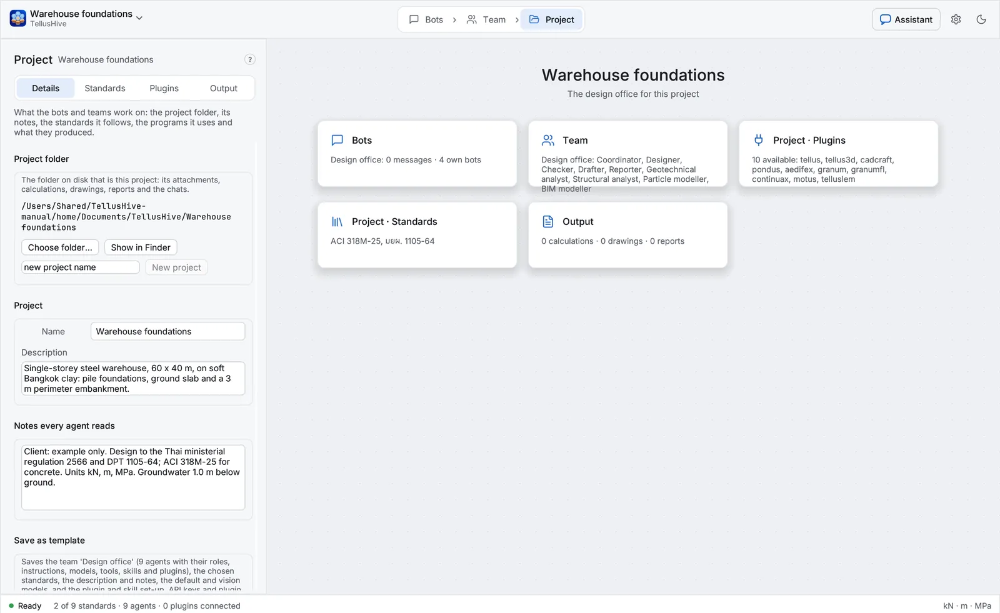
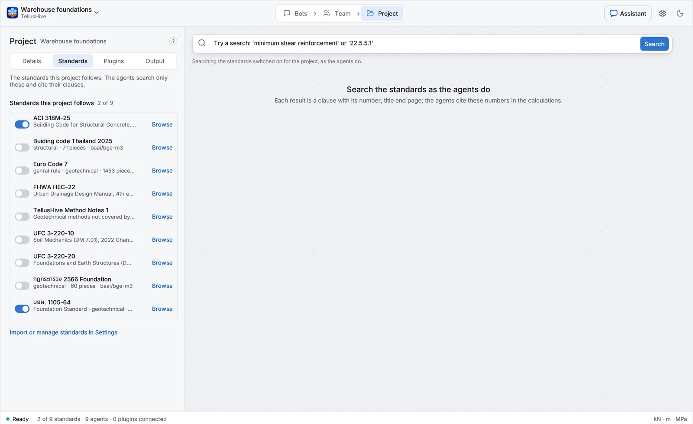
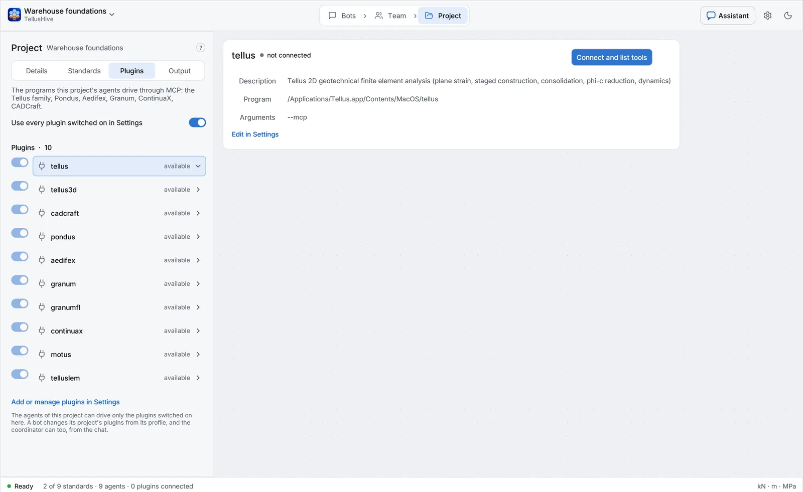
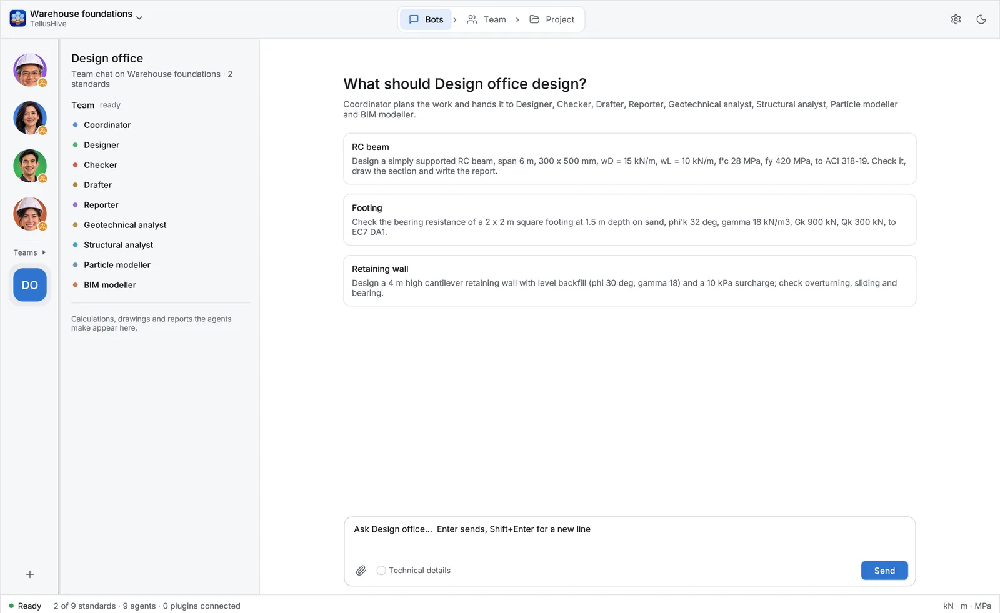

# 4. Projects

A project is what the bots and teams work on: a folder on disk that holds its description, the notes every agent reads, the standards and plugins it uses, the files you send and everything the agents produce. This chapter explains how to make and open projects, what each part of the **Project** layer does, the **Design office** where you talk to a whole team, and templates that save a set-up for later projects.

## Make or open a project

There are several ways to start. On the **Home** page, click **Empty project** or one of the worked examples, pick one of **Your templates** and click **New project**, or type a brief under **Or describe it** and click **Start design**, which makes a project and hands the brief to the design office at once. The **New project** item in the Home rail and the project menu at the top left of the window also make one, and **Open…** or **Open other…** under **Recent** opens an existing project folder.

New projects go into your projects folder, `~/Documents/TellusHive` unless you change it under **Settings › General**. A bot can also work in its own folder, or be pointed at any project in its **Setup** ([chapter 2](02-bots.md)).

## The Project layer

Click **Project** in the top bar. The tabs **Details**, **Standards**, **Plugins** and **Output** sit at the top of the left panel, and the canvas on the right shows a summary card for each part of the project, which you can click to open that part.

**Details.** **Project folder** shows the folder on disk that is this project, with **Choose folder…** to work in another folder (it opens it as a project, or makes it one) and **Show in Finder**. A name typed in the box below it, followed by **New project**, makes a new project next to the current one. **Project** holds the **Name** and the **Description**, a short statement of the job such as "Single-storey steel warehouse, 60 x 40 m, on soft Bangkok clay". **Notes every agent reads** is the place for facts that apply to every task: the client, the site, load assumptions, units, the groundwater level and office rules. Every agent reads these notes, so keep them short and factual. **Save as template** saves the whole set-up, described at the end of this chapter.

**Standards.** This tab switches on the standards from the library that this project follows. The agents search only the standards switched on here and cite their clauses, and with none switched on they search the whole library. The search box on the canvas lets you try a search the way the agents do. Standards are imported once, for every project, under **Settings › Standards library** ([chapter 5](05-standards-library.md)), and **Import or manage standards in Settings** takes you there.

**Plugins.** This tab chooses which plugins this project's agents may use. With **Use every plugin switched on in Settings** on, the project uses all of them, and that is the default. Switch it off to choose plugins one by one for this project. A plugin switched off in Settings shows "off in Settings" and cannot be used by any project. The canvas shows the selected plugin with its description, program and arguments, and **Connect and list tools** to test it. Plugins themselves are added and edited under **Settings › Plugins & MCP** ([chapter 6](06-plugins-and-mcp.md)), and **Add or manage plugins in Settings** goes there.

**Output.** The calculations, drawings, reports and pictures the agents have made for the project, with each item opening in the viewer. A calculation sheet shows every step with its clause and a PASS or FAIL, a drawing can be opened in CADCraft, and a report opens as a PDF.

## The Design office

The **Design office** is where you talk to a whole team about the open project, rather than to a bot. It appears in the **Bots** rail as the team's round badge, and the chat shows the team's agents on the left, the conversation in the middle and the files on the right. The empty chat offers the three example requests, and the box at the bottom works like a bot's: Enter sends, Shift+Enter adds a line, and the paper clip attaches files. **Technical details** shows the tool calls, reasoning and token counts. On the other pages, **Assistant** at the top right opens the same chat in a panel beside the page, so you can ask the team something while you edit its set-up.

When the agents work in an analysis program, TellusHive can open the program's window so you see the model, which you can switch off under **Settings › General**. When they build a BIM model in Aedifex, a 3D view of the model appears beside the chat and refreshes as the model changes. Drag to rotate, right-drag or Shift-drag to pan, scroll to zoom and double-click to fit.

## Files in a project folder

The project folder is an ordinary folder you can open in Finder or Explorer. It holds `project.json` (the name, description, notes, standards, plugins and team), `attachments/` for the files you send, `calcs/` for calculation sheets, `drawings/` for SVG, DXF and JSON drawings, `reports/` for the reports, `images/` for pictures, `models/` for the analysis models, `work/` for scripts and working files, and `sessions/` with the full log of every agent's work. Each bot and each team keeps its own conversation in the project, so several bots can work in one project without mixing their chats.

## Templates

A template saves the whole set-up so a new project can start from it: the team with each agent's role, instructions, model, tools, skills, plugins and delegation links, the chosen standards, the description and notes, the default and vision models, the plugins the team uses and the skill folders. API keys are never saved, and plugin environment values and HTTP headers are blanked, while the chat and the outputs stay with their project.

Save a template with **Save as template** on the **Details** tab or **Save as template…** in the project menu. On the **Home** page, **Your templates** lists them with **New project**, **Export…** and **Delete**, and **Import template…** reads a template file from another computer. When a template names plugins this computer does not have, they are added but switched off until their program is found, and standards missing from the library are listed so you can import them.
