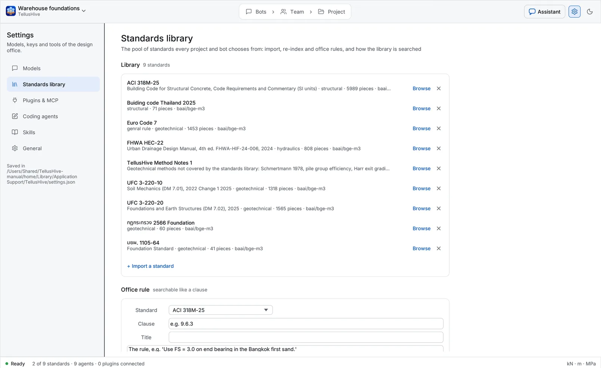

# 5. The standards library

The standards library is the set of design codes the agents may cite, such as ACI 318, Eurocode 7, the UFC manuals, the Thai ministerial regulation on foundations or DPT 1105-64. You import your own licensed copies once, and every project and bot then chooses from that one pool. The agents search the library before they calculate and cite the clause and page they used, which is what lets you trace each number in a design back to its source.

## Where the library lives

Open **Settings** and choose **Standards library**, or click **Standards library** in the Home rail. The page lists every standard with its code, name, discipline, the number of pieces it was split into and how it was indexed, and each row has **Browse** to read its clauses and **×** to delete it. A project or bot only switches standards on, under **Project › Standards** or in a bot's **Setup**, so deleting a standard here removes it for everyone, and TellusHive asks before it does.

## Import a standard

1. Click **+ Import a standard**.
2. Fill in **Code**, which is the name the agents cite, for example `ACI 318M-25`, `EN 1997-1:2004` or `มยผ. 1105-64`. The code is required.
3. Fill in **Name** with the full title, choose the **Discipline** (structural, geotechnical, steel, loads, seismic, highway, hydraulic or other), and add the **Country** and **Year**.
4. Click **Choose…** and pick the file. PDF, text (`.txt`) and Markdown (`.md`) are accepted, and a standard published in parts can be picked as several files at once.
5. Click **Import**. A progress bar shows while TellusHive extracts the text, splits it into clauses and indexes them. When it finishes, the standard appears in the list.
6. Switch the standard on for each project that follows it, under **Project › Standards**, or for a bot in its **Setup**.

After an import, try a search to check it. On **Project › Standards**, type a question the way an engineer would ask it, such as "allowable skin friction soft clay", and check that the right clause comes back with its number and page. If the clause numbers come out wrong, the PDF's layout probably confused the clause splitter, and a cleaned-up Markdown copy of the standard usually indexes better.

## Scanned PDFs

A scanned PDF is a set of pictures with no text, so it cannot be indexed, and the import stops with a message that the PDF is probably a scanned image. This is common for older Thai standards. Run optical character recognition on it first, for example with `ocrmypdf --language tha+eng in.pdf out.pdf`, check that the result has selectable text, and import the new file.

## How the library is searched

The **Embedding** setting at the bottom of the page decides how text is matched. **Simple: built-in, offline** matches words, word pieces and clause numbers, combined with keyword search. It is free, works offline and is good when the question names the clause or the exact term, but it does not understand meaning, so "uplift" does not find "buoyancy". **Embedding model through OpenRouter** finds clauses by meaning as well as by their words, in Thai and English. The default model `baai/bge-m3` is multilingual and costs about USD 0.01 per million tokens, a fraction of a cent for a whole standard. It uses the OpenRouter key from **Models**, and the text of the standard is sent to OpenRouter to be embedded.

A standard keeps the method it was indexed with. When you change the setting, the page lists the standards indexed another way and offers **Re-index**, which indexes them again with the current method so the whole library is searched the same way.

Two features help the agents use the library well. The **standards briefing** searches the library with the words of your request before an agent starts and puts the passages that really match in front of it, with source, clause and page, so even an agent that never searches by itself sees the method the task names. Then each agent can search on its own with `search_standards` and read a clause with `get_clause`. When nothing in the library matches, the search says so and asks the agent to state its own source, instead of passing off the nearest passage as the method. On 54 GeoTechBench items whose methods the library holds, a team on Claude Code solved 35 with the briefing against 26 without it (exact McNemar test, p = 0.022), whereas on 33 random items it changed nothing (31 against 31) and doubled the median run time. You can switch the briefing off by setting `harness.standards_briefing` to `false` in `settings.json`.

## Office rules

An office rule is a rule of your own design office that the agents should follow, such as "Use FS = 3.0 on end bearing in the Bangkok first sand" or "Use 40 mm cover to stirrups for all beams exposed to weather". Under **Office rule**, choose the **Standard** the rule belongs to, give a **Clause** number and a **Title** if you like, write the rule, and click **Add the rule**. The agents find it in a search like any clause of that standard, so it reaches every project that follows the standard.
