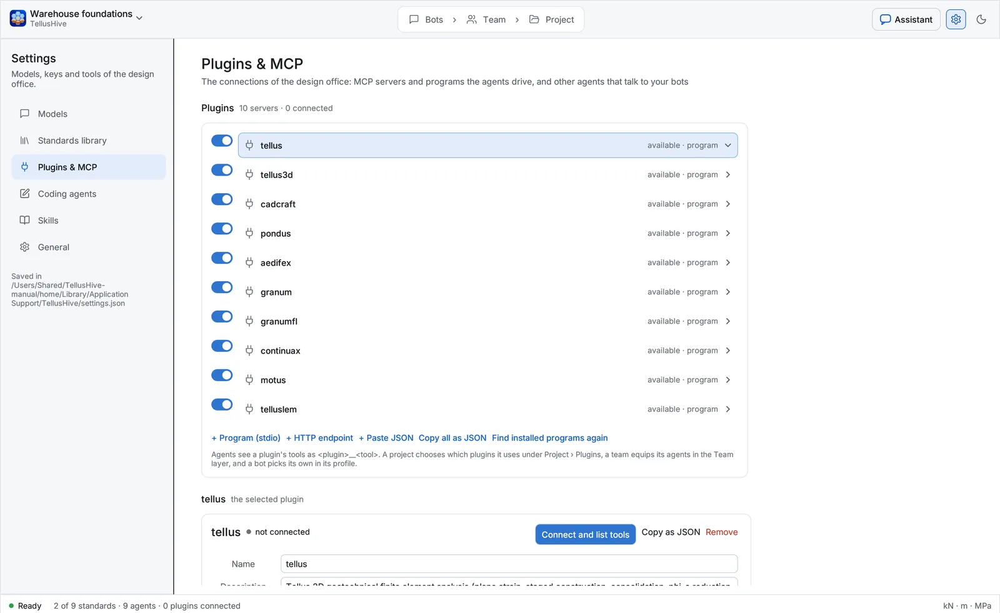
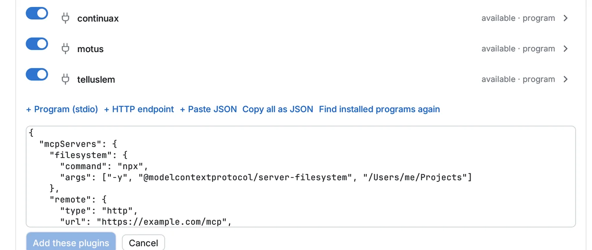

# 6. Plugins and MCP

A plugin is a program the agents can drive, such as Tellus for geotechnical finite element analysis, Pondus for structural analysis, Aedifex for BIM or CADCraft for drawings. Plugins speak the Model Context Protocol (MCP), the same protocol Claude Desktop, Claude Code and Cursor use, so any MCP server works as a plugin, whether it is a program on this computer or a service on the internet. This chapter explains how to add, test and remove plugins, how projects, teams and bots get them, and how other AI agents can connect to your bots in the other direction.

All connections are managed in one place: **Settings › Plugins & MCP**.



## The plugin list

Each row shows a plugin with a switch, its name, its state and whether it is a program or an HTTP endpoint. The switch decides whether projects, teams and bots may use the plugin at all. The state reads **available** when the plugin is switched on but not yet started, **connecting…** while it starts, the number of tools once it is connected, **failed** when it could not start, and **off** when it is switched off. A plugin starts on its own the first time an agent needs it, so you do not have to connect it by hand.

TellusHive knows the programs of the Tellus family and the others it works with, and on the first start it adds those it finds on this computer.

| Plugin | Program | Used by |
|---|---|---|
| `tellus` | Tellus, 2D geotechnical finite elements | Geotechnical analyst |
| `tellus3d` | Tellus3D, 3D geotechnical finite elements | Geotechnical analyst |
| `telluslem` | TellusLEM, slope stability by limit equilibrium | Geotechnical analyst |
| `motus` | Motus, 1-D seismic site response | Geotechnical analyst |
| `pondus` | Pondus, structural analysis and design | Structural analyst |
| `continuax` | ContinuaX, structural finite elements | Structural analyst |
| `granum` | Granum, discrete element method | Particle modeller |
| `granumfl` | GranumFL, DEM with fluid | Particle modeller |
| `aedifex` | Aedifex, BIM modeller | BIM modeller |
| `cadcraft` | CADCraft, CAD drafting | Drafter, BIM modeller |

After you install one of these programs, click **Find installed programs again** so TellusHive finds it and fills in its path.

## Add a plugin

There are three ways to add a plugin, and all of them end in the same form, so you can correct anything afterwards.

**A program on this computer (stdio).** Click **+ Program (stdio)**. A new entry appears and is selected. Give it a **Name**, which the agents see in front of its tools (`<name>__<tool>`), a **Description** that tells the agents what it is for, the **Program** to start (type the path or use **Browse…**), and its **Arguments**, such as `--mcp`. Put an argument with spaces in double quotes. **Working dir** sets the folder the program starts in, and **Environment** takes `KEY=value` lines for variables the program needs, such as an API key of its own.

**An MCP server that is already running (HTTP).** Click **+ HTTP endpoint**, set the **URL (HTTP)**, for example `https://example.com/mcp`, and add any **HTTP headers** as `Name: value` lines, such as `Authorization: Bearer <token>`. TellusHive speaks MCP's streamable HTTP transport, so an older server that offers only Server-Sent Events (SSE) may not connect.

**Pasted JSON, in the format Claude uses.** Click **+ Paste JSON**, paste a configuration, and click **Add these plugins**. TellusHive reads the `mcpServers` block of Claude Desktop (`claude_desktop_config.json`), Claude Code (`.mcp.json`) and Cursor, the `servers` block of VS Code, a bare map of servers, or a single server with its own `"name"`. For each server it reads `command`, `args`, `env`, `cwd`, `url`, `headers`, `type` and `disabled`, and also `description` and `timeout` when they are present. One paste can add several servers, and a server with the same name as an existing plugin replaces it.



```json
{
  "mcpServers": {
    "filesystem": {
      "command": "npx",
      "args": ["-y", "@modelcontextprotocol/server-filesystem", "/Users/me/Projects"],
      "env": { "DEBUG": "1" }
    },
    "remote": {
      "type": "http",
      "url": "https://example.com/mcp",
      "headers": { "Authorization": "Bearer <token>" }
    }
  }
}
```

The message under the box says which plugins were added or replaced, and it explains any mistake, such as invalid JSON, a server with neither `command` nor `url`, or a name with spaces or a double underscore, in which case nothing is added. Variables written as `${VAR}` are kept as written, not expanded, so put the real value in or set it under **Environment** afterwards. In the other direction, **Copy all as JSON** copies every plugin in the `mcpServers` format, and **Copy as JSON** beside a selected plugin copies just that one, ready to paste into Claude Desktop, Claude Code or Cursor.

## Test, inspect and remove a plugin

Select a plugin and click **Connect and list tools**. TellusHive starts the program or reaches the endpoint, and the state changes to the number of tools. The **Tools** card then lists each tool with its description and the arguments it takes, and **Server log** shows what the program wrote to its error output, which is the first place to look when a plugin fails. **Disconnect** stops it again. **Call timeout** sets how long one tool call may take, 600 s for a plugin you add, which you can raise for long analyses. **Remove** deletes the plugin after you confirm, and projects, teams and bots that used it lose its tools.

## Who may use a plugin

A plugin switched on in Settings can be used at three levels, and each level narrows the one above. A **project** chooses which plugins its agents may use under **Project › Plugins**, with all of them allowed by default ([chapter 4](04-projects.md)). A **team** equips each agent with the plugins it needs in the **Team** layer ([chapter 3](03-teams-and-agents.md)), so the geotechnical analyst gets Tellus and the drafter gets CADCraft. A **bot** picks its own plugins under **Standards and plugins** in its **Setup**, and these replace its project's choice ([chapter 2](02-bots.md)). The coordinator can also change a project's plugins from the chat with the tools `list_plugins` and `set_project_plugins`.

Give each program only to the agents that use it. Every tool description is sent with every model call, and a provider accepts at most 128 tools in one request, so an agent with many plugins costs more and reaches its largest plugins through two gateway tools, `plugin_tools` and `plugin_call`.

## Let other agents talk to your bots

The section **Other agents connect here**, at the bottom of the same page, runs an MCP server inside TellusHive. Other AI agents on this computer, such as Claude Code, Codex, Antigravity or Claude Desktop, can connect to it and use four tools: `list_bots`, `list_teams`, `ask_bot` and `ask_team`. A message sent with `ask_bot` lands in that bot's chat in the window, so you see the work, and the reply goes back to the calling agent when the run ends.

The server listens on `127.0.0.1:8795` by default, on this computer only. Switch it on or off with **Let other agents talk to the bots and teams while TellusHive runs**, change the **Port** if 8795 is taken, and keep the **Token** secret, because every client must send it. **New token** makes a new one, which turns away clients that hold the old one. **Copy client config** copies a ready configuration with the address and the token, for Claude Code, Claude Desktop, Cursor and others, and **Copy token** copies the token alone. Changes apply when TellusHive restarts.

To add TellusHive to Claude Code, for example, paste the copied configuration into the project's `.mcp.json`, or into the `mcpServers` block of Claude Desktop's configuration. ChatGPT and Grok run in the cloud, so they need a public HTTPS tunnel to this port, and [chapter 9](09-cloud-and-iphone.md) describes a safer way to reach the bots from outside.
