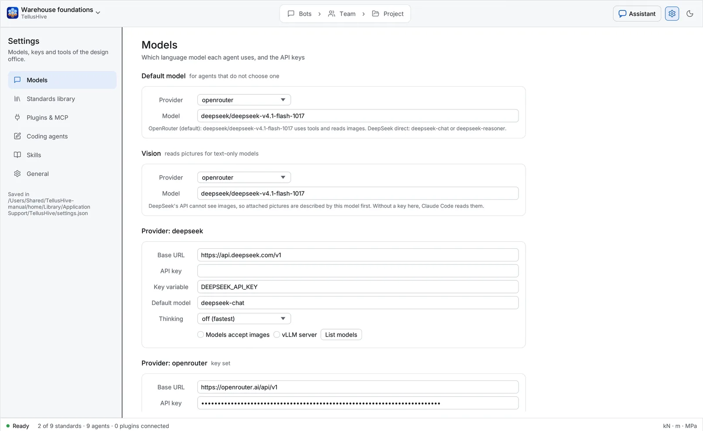
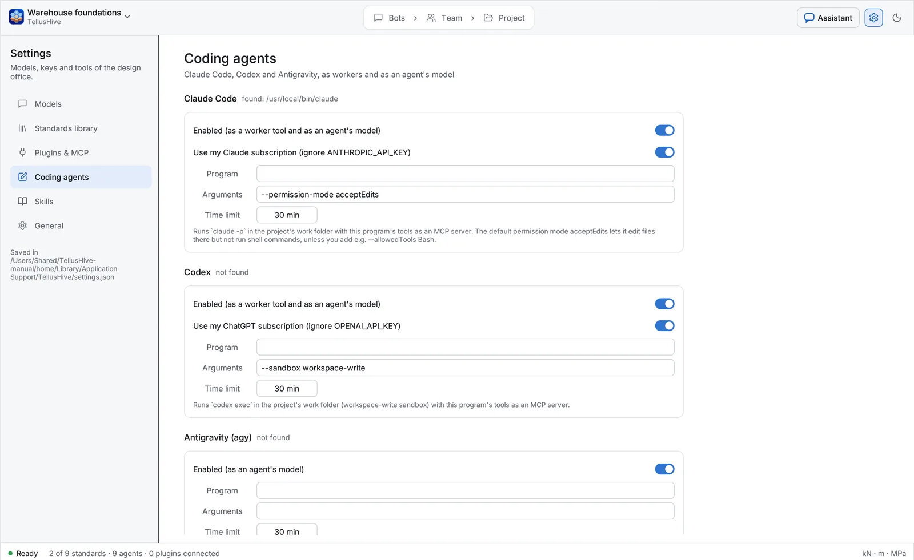

# 7. Models and providers

Every agent and every bot runs on a language model, and a provider is where that model comes from: a model API on the internet, a model served on your own hardware, or a coding agent such as Claude Code that you are already signed in to. This chapter explains the **Models** page of the settings, each kind of provider, and the choices that affect speed and cost.



## The Models page

**Default model** sets the **Provider** and **Model** for every agent and bot that does not choose its own. The default is OpenRouter with `deepseek/deepseek-v4.1-flash-1017`, which uses tools and reads images. **Vision** sets the model that describes attached pictures for models that cannot see images, such as DeepSeek's own API, and without a key there, Claude Code reads the pictures instead.

Below these comes one card per provider. A model API provider has a **Base URL**, an **API key** (or the name of the environment variable that holds it, in **Key variable**), a **Default model**, a **Thinking** level, a switch for whether its models accept images, a **vLLM server** switch and **List models**, which asks the API which models it serves and so also checks the address and the key. **+ Provider (any OpenAI-compatible endpoint)** adds a provider of your own.

## The providers

| Provider | What it is | Key |
|---|---|---|
| `openrouter` | Many models through one API, the default | `OPENROUTER_API_KEY` |
| `deepseek` | DeepSeek's own API (`deepseek-chat`, `deepseek-reasoner`) | `DEEPSEEK_API_KEY` |
| `openai` | OpenAI's API | `OPENAI_API_KEY` |
| `ollama` | A local Ollama server at `http://localhost:11434/v1` | none |
| `vllm` | A vLLM server on this computer at `http://localhost:8000/v1` | none unless the server sets one |
| `vllm-vast` | A vLLM server on a rented GPU, such as Vast.ai | the server's key |
| `claude-code` | Claude Code on your Claude login | none |
| `codex` | Codex on your ChatGPT login | none |
| `antigravity` | Google Antigravity (`agy`) on your Google login | none |

A key typed into **API key** is saved in `settings.json`, which only your user account can read, and a key in the environment variable named under **Key variable** works without being saved anywhere.

## Claude Code, Codex and Antigravity as a model

Any agent or bot can run on Claude Code, Codex or Antigravity instead of a model API. Choose the provider `claude-code`, `codex` or `antigravity` for it, and it uses your subscription with no API key. The model name is optional: `sonnet`, `opus` or `haiku` for Claude Code, or empty for the program's default. The program receives the agent's own tools through TellusHive's MCP server, so it calculates, searches the standards and drives plugins like any other agent, and every call is logged in the project's `sessions/` folder. A plugin that a bot on Antigravity switches on from the chat reaches it from the next message, and the tool server writes which plugins it served, and why one failed, to the project's `sessions/mcp-server.log`.

**Settings › Coding agents** holds the settings of the three programs. Each has **Enabled**, **Program** (empty searches the usual places, and the line under the title says where it was found), **Arguments** and **Time limit**. For Claude Code and Codex, **Use my Claude subscription** and **Use my ChatGPT subscription** remove `ANTHROPIC_API_KEY` or `OPENAI_API_KEY` from the program's environment, so a key in your shell does not override the login. Claude Code runs with `--permission-mode acceptEdits` by default, which lets it edit files in the project's work folder but not run shell commands, and Codex runs in its workspace-write sandbox.



These programs are much slower per step than a model API, because each step starts the program with its own large system prompt, so they suit programming tasks and careful checks better than routine design steps. A team can mix providers freely, for example a coordinator on Claude Code that delegates to a designer on DeepSeek.

## Your own model on vLLM

An agent can run on an open-weight model that you serve yourself with vLLM, on this computer or on a GPU rented from a service such as Vast.ai, so your data stays on hardware you control. Start the server with tool calling switched on, because the agents work through tools:

```sh
vllm serve Qwen/Qwen3-32B --enable-auto-tool-choice --tool-call-parser hermes \
  --reasoning-parser qwen3 --max-model-len 32768 --api-key <key>
```

The tool-call parser depends on the model: `hermes` for Qwen, `llama3_json` for Llama, `mistral` for Mistral and `openai` for gpt-oss. For a server on this computer, choose the `vllm` provider and leave the key empty unless the server was started with `--api-key`. For a Vast.ai instance, set the **Base URL** of `vllm-vast` to `http://<instance public IP>:<external port>/v1` and enter the same key as `--api-key`, because that port is open to the internet. An SSH tunnel (`ssh -L 8000:localhost:8000 -p <port> root@<ip>`) avoids the open port, and the local `vllm` provider then reaches the instance.

When **Default model** is empty, the agents use the model the server lists, so you do not have to type its name. Restart TellusHive after you load a different model at the same address. Any other OpenAI-compatible provider becomes a vLLM provider with its **vLLM server** switch. Run a short task on the model you serve and check that it calls the tools correctly before you give it a design.

## Thinking

**Thinking** decides how much a model reasons before it answers: off, low, medium or high, or the provider's default. Every provider and agent starts with thinking off, because reasoning makes routine steps much slower. In one recorded pile-cap run, the designer on DeepSeek V4.1 Flash spent 85 to 176 s per step writing up to 90,000 characters of reasoning, whereas with thinking off its steps took 2 to 13 s. Switch thinking on for an agent whose work needs judgement, such as the checker, and leave it off for the drafter and the reporter. The level is set per provider in **Models**, per agent in **Team**, and per bot in its **Setup**, and a provider that does not support it ignores it.

## A bot's own API

A bot can call its own model API instead of a shared provider, which is useful when one bot should use a different account or a model the others do not. In the bot's **Setup**, choose **Own API** under **Model** and fill in the **Base URL**, **API key** and **Model**, then click **List models** to check them. The key is kept in the bot's own file, readable only by you, and the other bots and teams are not affected.

## Token use

The window counts tokens while the agents work. The top bar shows the running total of the task, the chat shows the tokens of each step when **Show the steps in detail** is on, and a card at the end of each task gives the totals with a table by agent and model. The counts cover the agents' model calls only, so picture descriptions by the vision model, embeddings, summaries and work done inside Claude Code or Codex are not included, and no cost is shown because the app holds no prices.
