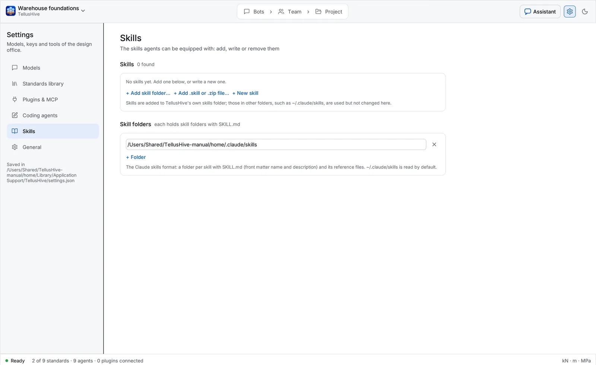
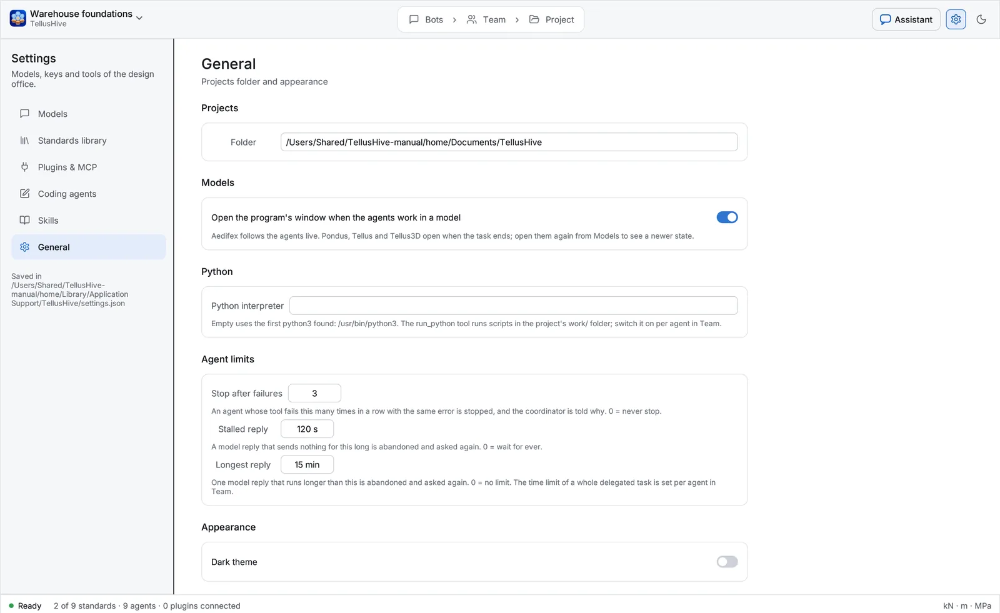

# 8. Skills and general settings

This chapter covers the two remaining pages of the settings. **Skills** holds the reference knowledge you can give the agents, and **General** holds the projects folder, the analysis program windows, Python, the limits that stop a stuck agent, and the theme.

## Skills

A skill is a folder of expert knowledge that an agent loads when it needs it, such as a method for designing shallow foundations to Eurocode 7 or a house style for calculation reports. Each skill is a folder with a `SKILL.md` file, whose front matter gives the skill's `name` and a one-line `description`, and any reference files the skill uses. This is the Claude skills format, so skills written for Claude work in TellusHive unchanged, and `~/.claude/skills` is read by default. An agent sees only the one-line description of each skill it is equipped with and reads the full text with `read_skill` when the task calls for it, so a long skill costs nothing until it is used.

The **Skills** page lists the skills found, with three ways to add one. **+ Add skill folder…** copies a skill folder, **+ Add .skill or .zip file…** unpacks a packaged skill, and **+ New skill** writes a new one from a **Name** and a **Description**, which you then fill in with its method. New skills go into TellusHive's own skills folder, whereas skills in other folders, such as `~/.claude/skills`, are used but not changed here. **Skill folders** lists the folders that are scanned, and **+ Folder** adds another.

Give skills to agents in the **Team** layer, with **All skills** or by ticking them one by one, and to a bot in its **Setup**.

## General

**Projects.** **Folder** is where new projects are made, `~/Documents/TellusHive` by default.

**Models.** **Open the program's window when the agents work in a model** opens the window of an analysis program so you see the model the agents build. Aedifex follows the agents live, whereas Pondus, Tellus and Tellus3D open when the task ends, and you can open them again from **Models** to see a newer state.

**Python.** **Python interpreter** chooses the Python that the `run_python` tool uses to run scripts in the project's `work/` folder. Empty uses the first `python3` found, and the line below names it. On Windows, empty finds Python from python.org, conda (Miniconda, Miniforge or Anaconda) and the Microsoft Store, preferring the newest python.org install and taking a Store install last. Install the packages your scripts need, such as NumPy or SciPy, into that interpreter. An agent can run Python only if `run_python` is switched on for it in **Team**.

**Agent limits.** **Stop after failures** stops an agent whose tool fails this many times in a row with the same error, and tells the coordinator why (0 never stops). **Stalled reply** abandons a model reply that sends nothing for this many seconds and asks again (0 waits for ever). **Longest reply** abandons one model reply that runs longer than this many minutes and asks again (0 sets no limit). The time limit of a whole delegated task is set per agent in **Team**.

**Appearance.** **Dark theme** switches the window to dark colours, and the moon at the top right of the window does the same.

All settings are saved in `settings.json` in the data folder, and the bottom of the settings rail shows its path.
