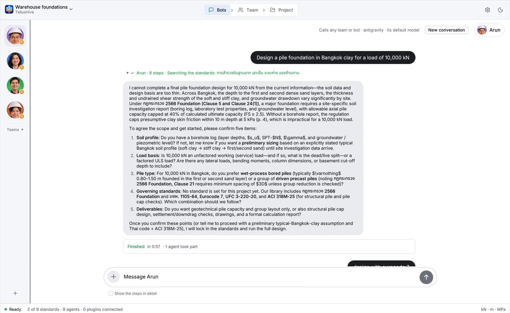

# TellusHive user manual

This manual explains how to use TellusHive 0.1.9, the open-source design office of AI agents for civil engineers. It walks through the window from the first start to a checked design, and it gives the details of every setting, so you can read it from the beginning or jump to the chapter you need. The screenshots come from the program itself, and the names of buttons and fields are written in **bold** exactly as they appear on screen.

## Chapters

1. [Getting started](01-getting-started.md): installing TellusHive, the first start, adding a model and a key, and how the window is laid out.
2. [Bots](02-bots.md): making a bot, its picture, character, model, calls, standards, plugins and project, and working with it in the chat.
3. [Teams and agents](03-teams-and-agents.md): the design office, the coordinator and the specialists, delegation links, each agent's model, tools, skills and plugins, and the limits that keep a run short.
4. [Projects](04-projects.md): making and opening projects, the project folder, notes, the standards and plugins a project uses, the Design office, outputs and templates.
5. [The standards library](05-standards-library.md): importing standards, scanned PDFs, the embedding setting, re-indexing, office rules and how the agents search.
6. [Plugins and MCP](06-plugins-and-mcp.md): adding MCP servers as programs, HTTP endpoints or pasted JSON, testing them, giving them to projects, teams and bots, and letting other agents talk to your bots.
7. [Models and providers](07-models-and-providers.md): OpenRouter, DeepSeek, OpenAI, Ollama, vLLM, Claude Code, Codex and Antigravity, the vision model, thinking and a bot's own API.
8. [Skills and general settings](08-skills-and-general.md): skills, the projects folder, Python, agent limits and appearance.
9. [The cloud server and the iPhone app](09-cloud-and-iphone.md): running the bots on a cloud machine and reaching them from a phone.
10. [Command line, data and troubleshooting](10-command-line-and-troubleshooting.md): the terminal commands, where TellusHive keeps its files, and what to do when something does not work.

## Before you rely on a result

TellusHive is a developer preview, so its settings and file formats may change between versions. The agents calculate to the standards you give them and a second agent checks the work, but they can still be wrong, so check every design yourself before you use it. The agents can also run code and drive programs on your computer, and [SAFETY.md](../SAFETY.md) explains what they are allowed to do.
